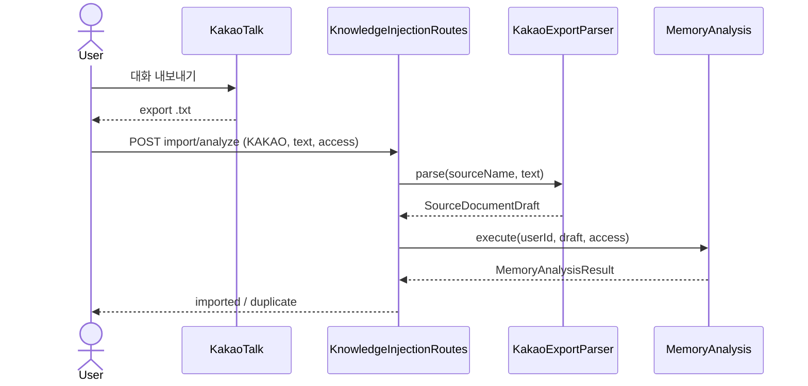
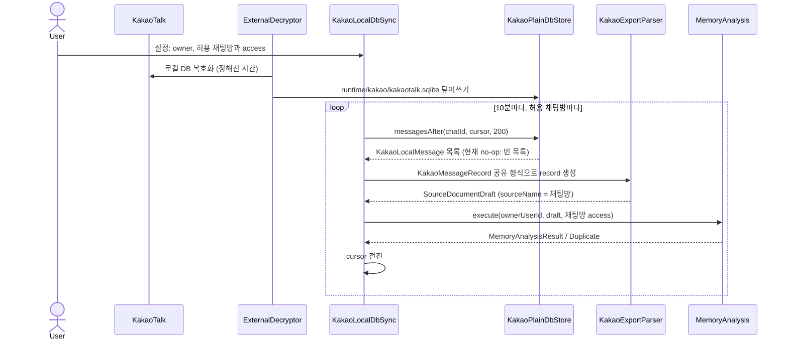

# Kakao local DB sync

외부 도구가 정해진 시간에 카카오톡 PC 로컬 DB를 평문 SQLite로 풀어 두면, 허용한 채팅방의 새 메시지를
주기적으로 `MemoryAnalysis`에 넣는 driving adapter다. 복호화·키 추출은 외부 도구 소관이며 이 저장소에
두지 않는다. 새 application port는 없다. HTTP 내보내기 업로드 경로는 그대로 두며 백필용으로 함께 쓴다.

## 입력 위치

| 항목 | 기본값 | 비고 |
|---|---|---|
| 평문 DB | `runtime/kakao/kakaotalk.sqlite` | 외부 도구가 이 경로를 덮어쓴다. `KAKAO_LOCAL_DB_PATH`로 바꿀 수 있다 |
| 커서 | `runtime/kakao/sync-cursor.json` | 채팅방별 마지막 `logId`. 지워도 dedup 때문에 결과는 같다 |

`runtime/kakao/`는 git에서 제외한다.

## 설정

`KAKAO_LOCAL_DB_CHATS_JSON`이 없으면 수집하지 않는다. 목록에 없는 채팅방은 읽지 않는다.

```
KAKAO_LOCAL_DB_OWNER_USER_ID=dad
KAKAO_LOCAL_DB_CHATS_JSON=[{"chatId":"100","sourceName":"가족 단톡방","isPublic":false,"allowedUserIds":["mom","dad"]}]
```

- `ownerUserId`: `MemoryAnalysisRequest.userId`로 쓰는 등록 사용자.
- 채팅방의 access는 고정이다. 바꾸면 이미 저장된 record와 충돌해 그 채팅방은 멈춘다
  (`ConflictingSourceAudienceException`).

## 책임 경계

| 구성 요소 | 책임 | DB 스키마 의존 |
|---|---|---|
| `KakaoPlainDbStore` | 평문 SQLite에서 채팅방별 텍스트 메시지를 `logId` 오름차순으로 읽어 `KakaoLocalMessage`로 매핑 | **예. 유일한 곳.** 지금은 스키마를 몰라 빈 목록을 돌려주는 no-op |
| `KakaoLocalStore` | 위 구현의 경계 인터페이스 | 아니오 |
| `KakaoLocalDbSync` | allowlist 순회, 배치(200건), `MemoryAnalysis` 호출, 커서 전진 | 아니오 |
| `KakaoSyncCursor` | 채팅방별 커서 파일 | 아니오 |
| `KakaoMessageRecord` | 내보내기 파서와 공유하는 record 형식·dedup key | 아니오 |
| `KakaoLocalDbSyncWorker` (app) | 10분 간격 스케줄, 실패 격리, 로그 | 아니오 |

스키마가 정해지면 `KakaoPlainDbStore.messagesAfter`만 구현한다. 계약은 `KakaoLocalStore` KDoc에 있다.

## 흐름

AS-IS: 사람이 내보내기 파일을 HTTP로 올린다.



TO-BE: 수집 트리거가 사람의 업로드에서 주기 폴링으로 바뀐다. HTTP 경로는 그대로다.



`KakaoExportParser` 노드는 두 경로가 공유하는 `KakaoMessageRecord`를 뜻한다. `MemoryAnalysis` 이후 저장과
Topic 할당 outbox 흐름은 바뀌지 않는다.

## 중복 제거

DB 메시지의 dedup key는 내보내기와 같은 `sha256(sender, 분 단위 KST 시각, text)`다. 그래서 같은 메시지를
내보내기로 먼저 넣었든 DB로 먼저 넣었든 한 번만 저장된다. 내보내기와 마찬가지로 같은 사람이 같은 분에 보낸
같은 문장은 하나로 합쳐진다.

## 실패 계약

- 배치가 저장되면(`MemoryAnalysisResult` 또는 전부 이미 분석된 `DuplicateSourceRecordsException`) 커서를
  그 배치의 마지막 `logId`로 옮긴다.
- 그 밖의 실패(DB 읽기, 분석 불가, 권한·audience 충돌)는 그 채팅방만 커서에서 멈추고 다음 주기에 다시
  시도한다. 다른 채팅방은 계속 진행한다.
- 라운드 밖으로 예외가 새지 않으므로 스케줄은 끊기지 않는다.
