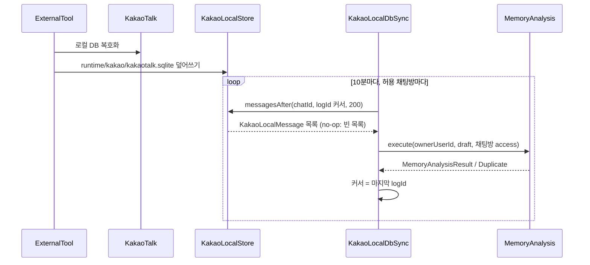
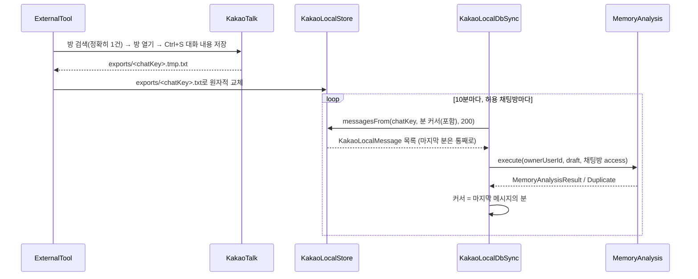

# Kakao export sync

외부 스크립트 KakaoExporter(`tools/kakao-exporter/`)가 카카오톡 PC의 공식
"대화 내용 저장"으로 허용한 채팅방마다 `<chatKey>.txt`를 만들어 두면, 그 파일의 새 메시지를 주기적으로
`MemoryAnalysis`에 넣는 driving adapter다. 카카오톡 로컬 DB 파일, 복호화, 키 추출, 프로세스 메모리는 다루지
않는다. 새 application port는 없다. HTTP 내보내기 업로드 경로는 그대로 두며 백필용으로 함께 쓴다.

## 입력 위치

| 항목 | 기본값 | 비고 |
|---|---|---|
| 내보내기 폴더 | `runtime/kakao/exports/<chatKey>.txt` | KakaoExporter가 원자적으로 교체한다. `KAKAO_EXPORT_DIR`로 바꿀 수 있다 |
| 커서 | `runtime/kakao/sync-cursor.json` | 채팅방별 마지막 메시지의 분(ISO instant). 지워도 dedup 때문에 결과는 같다 |

`runtime/kakao/`는 git에서 제외한다.

## 설정

`KAKAO_LOCAL_DB_CHATS_JSON`이 없으면 수집하지 않는다. 목록에 없는 채팅방은 내보내지도 읽지도 않는다.
KakaoExporter도 같은 설정을 읽는다.

```
KAKAO_LOCAL_DB_OWNER_USER_ID=dad
KAKAO_LOCAL_DB_CHATS_JSON=[{"chatKey":"family","roomName":"우리 가족","sourceName":"가족 단톡방","isPublic":false,"allowedUserIds":["mom","dad"]}]
```

- `chatKey`: 내보내기 파일 이름. `[A-Za-z0-9_-]+`, 중복 불가.
- `roomName`: 카카오톡 채팅방 이름. KakaoExporter가 이 이름이 정확히 하나만 검색될 때만 내보낸다. 중복 불가.
- `ownerUserId`: `MemoryAnalysisRequest.userId`로 쓰는 등록 사용자.
- 채팅방의 access는 고정이다. 바꾸면 이미 저장된 record와 충돌해 그 채팅방은 멈춘다
  (`ConflictingSourceAudienceException`).

## 책임 경계

| 구성 요소 | 책임 | 입력 형식 의존 |
|---|---|---|
| KakaoExporter (`tools/`) | 카카오톡 창 조작, 채팅방별 txt 저장, 원자적 교체 | 카카오톡 UI |
| `KakaoExportFolderStore` | `<chatKey>.txt`를 파싱해 커서 분 이후 메시지를 `KakaoLocalMessage`로. 텍스트만 수집: 본문이 첨부 자리표시(`사진`, `동영상`, `이모티콘`, `파일: <이름>`)뿐인 메시지 제외 | **예. 유일한 곳** |
| `KakaoExportParser` | 내보내기 txt의 메시지 단위 파싱(발신자, 분 단위 시각, 본문). HTTP 업로드와 공유 | 예 |
| `KakaoLocalStore` | 위 구현의 경계 인터페이스. 배치는 같은 분을 쪼개지 않는다 | 아니오 |
| `KakaoLocalDbSync` | allowlist 순회, 배치(200건), `MemoryAnalysis` 호출, 커서 전진 | 아니오 |
| `KakaoSyncCursor` | 채팅방별 커서 파일 | 아니오 |
| `KakaoMessageRecord` | 내보내기 파서와 공유하는 record 형식·dedup key | 아니오 |
| `KakaoLocalDbSyncWorker` (app) | 10분 간격 스케줄, 실패 격리, 로그 | 아니오 |

## 흐름

AS-IS: 외부 도구가 로컬 DB를 평문 SQLite로 풀어 두고, 스키마 의존 store가 읽는다(스키마 미확정 no-op).



TO-BE: 외부 도구가 카카오톡 공식 내보내기를 자동화하고, store는 txt를 직접 읽는다. 중간 SQLite는 없다.



`ExternalTool`은 AS-IS에서 복호화 도구, TO-BE에서 KakaoExporter다. `KakaoLocalStore`는 AS-IS에서
`KakaoPlainDbStore`, TO-BE에서 `KakaoExportFolderStore`다. `MemoryAnalysis` 이후 저장과 Topic 할당 outbox
흐름은 바뀌지 않는다.

## 커서와 중복 제거

내보내기는 시각을 분 단위로만 준다. 그래서 커서는 마지막 메시지의 분이고, 다음 라운드는 그 분부터(포함) 다시
읽는다. 내보내기 시점에 그 분이 끝나지 않아 나중에 같은 분 메시지가 더 생겨도 놓치지 않는다. 다시 읽은
메시지는 dedup key가 같아 `DuplicateSourceRecordsException`(전부 중복) 또는 `alreadyAnalyzed`로 흡수된다.
한 라운드 안에서는 배치가 분을 쪼개지 않으므로 다음 배치를 다음 분부터 읽는다.

dedup key는 HTTP 업로드와 같은 `sha256(sender, 분 단위 KST 시각, text)`다. 같은 메시지를 업로드로 먼저
넣었든 폴더로 먼저 넣었든 한 번만 저장된다. 같은 사람이 같은 분에 보낸 같은 문장은 하나로 합쳐진다.

## 실패 계약

- 배치가 저장되면(`MemoryAnalysisResult` 또는 전부 이미 분석된 `DuplicateSourceRecordsException`) 커서를
  그 배치의 마지막 분으로 옮긴다.
- 그 밖의 실패(파일 읽기·파싱, 분석 불가, 권한·audience 충돌)는 그 채팅방만 커서에서 멈추고 다음 주기에
  다시 시도한다. 다른 채팅방은 계속 진행한다.
- 파일이 아직 없으면 빈 목록이다. 날짜 구분선이 없어 날짜를 모르는 메시지는 건너뛴다.
- 라운드 밖으로 예외가 새지 않으므로 스케줄은 끊기지 않는다.
