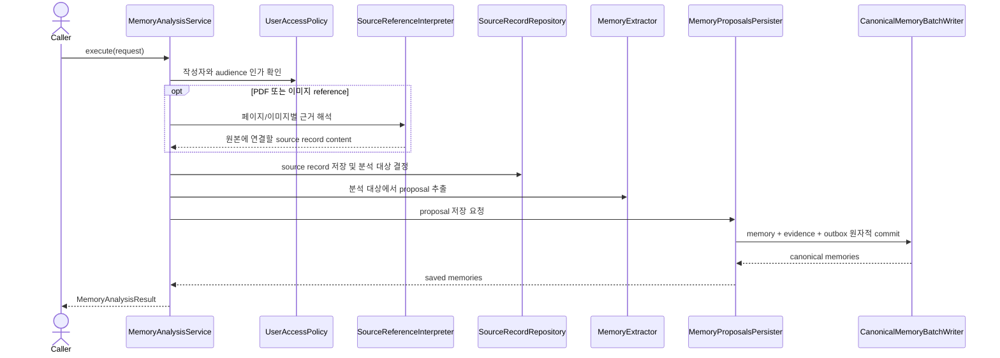
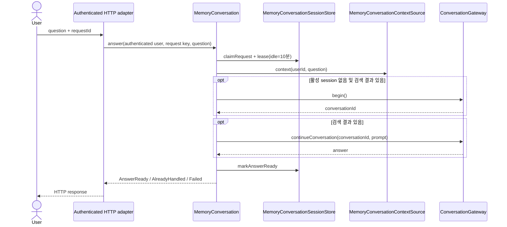

# Application use cases

이 디렉터리는 input port를 구현하고 domain 규칙과 output port를 조합하는 기술 중립적인
application orchestration을 담는다. HTTP, SQLite, Codex, Ollama 같은 기술 이름과
payload 형식은 여기에서 직접 다루지 않는다.

## 패키지 지도

| 패키지 | 책임 | 상세 문서 |
|---|---|---|
| `identity` | 사용자를 이름·비밀번호로 등록·로그인시키고, 목록을 제공하고 인가한다. | [identity](identity/README.md) |
| `group` | 저장된 Topic을 Group에 배치·분할하고 원자 확정한다. 명시적 내부 호출 전용이다. | [group](group/README.md) |
| `topic` | Memory를 cosine으로 가까운 Topic들에 배정한 뒤 Group 정리까지 이어가고, 대화용 Topic 검색을 ACL slice로 거른다. | [topic](topic/README.md) |
| `memory/analysis` | source record를 분석해 canonical memory로 저장하고 후처리를 요청한다. | [analysis](memory/analysis/README.md) |
| `memory/conversation` | 질문 멱등성, 10분 세션 lease, context와 provider conversation을 관리한다. | [conversation](memory/conversation/README.md) |
| `memory/write` | proposal을 원자적으로 저장하고 Topic 할당 outbox를 같은 transaction으로 남긴다. | [write](memory/write/README.md) |

## 전체 memory 쓰기 흐름

Canonical database commit까지가 요청 성공의 기준이다. Topic 배정은 commit에 함께 남긴 outbox를
worker가 이후에 처리하며, 실패해도 저장된 canonical memory를 되돌리지 않는다.

HTTP 지식 입력은 인증된 application userId로 `MemoryAnalysis`를 직접 호출한다.

## HTTP memory 응답 흐름

사용자 목록과 application UserId는 공통 identity 기능이다. Slack 등록·최초 질문 재개·
명령과 DM 처리는 제거했다. HTTP 인증은 사람의 이름·비밀번호 로그인 세션 cookie와 기계의 Bearer API key를 받는다.
세션 격리, 동일 요청 답변 재사용, 10분 idle 만료는 `MemoryConversation`이 관리한다.

## 문서 유지 규칙

- 실제 use case 구현이 있는 각 leaf package에는 `README.md`를 둔다.
- 각 README에는 최소 하나의 Mermaid `sequenceDiagram`으로 정상 흐름과 중요한 분기를 표현한다.
- input/output port나 호출 순서가 바뀌면 같은 변경에서 해당 README를 갱신한다.
- diagram participant에는 구현 기술보다 application 역할 또는 port 이름을 사용한다.
