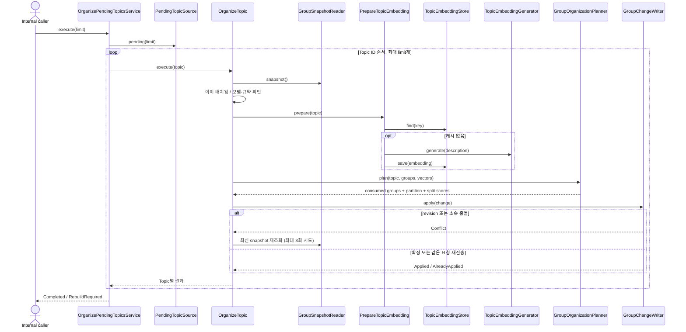

# Topic → Group organization

명시적으로 저장된 Topic을 component로 사용해 Group을 생성·배치·분할한다.
내부 input port는 `OrganizePendingTopics.execute(limit)`이며 앱의 `organizeTopics`로 제공된다.
HTTP·worker·Memory 분석 경로에서는 호출하지 않는다. 앱 시작만으로 실행되지 않는다.
현재 Topic 자동 생성 경로는 없으므로 기존 trusted Topic 저장 경로로 입력을 준비해야 한다.

## 책임과 정상 흐름

`OrganizePendingTopicsService`는 batch 제한과 결과 집계, `OrganizeTopic`은 한 Topic의 실행과
충돌 재시도, `PrepareTopicEmbedding`은 설명과 규약에 맞는 벡터 재사용·생성을 담당한다.
배치·분할 판단은 `domain/group/GroupOrganizationPlanner`가 순수 정책을 조합한다.
Application은 provider·DB 타입을 참조하지 않고 output port를 호출한다.

## 정책

- Topic 설명을 `passage: ` 입력 규약으로 임베딩한다. Topic 크기는 적절하다고 가정한다.
- cosine이 attach threshold를 **초과**하면 가장 가까운 Group에 배치한다. 동점은 작은 Group ID다.
- 상한 초과 시 연결 성분과 결정적 이분할로 최대 두 종류의 partition 후보를 만든다.
- 각 후보를 동일 Topic 집합과 동일한 주변 Group snapshot에서 평가한다.
- xMemory `SparsityScore + SemScore`를 사용한다. SparsityScore는 크기 균형이며 Group 수의 벌점이 아니다.
- 크기 제약을 만족하는 후보 중 점수가 높은 것을 선택한다. 동점이면 Group 수, Topic ID 순이다.
- 점수가 개선되지 않아도 상한을 지키며 `GroupSplit.Divided.forced`와 before/after 점수를 반환한다.
- 분할 시 최소 Topic ID를 가진 조각이 기존 Group ID를 유지한다.
- 정책은 `GroupPolicySettings(attachThreshold=0.6, maxTopics=12, splitThreshold=0.65)`로 조정한다.
  앱 factory의 `groupSettings` 인자로 주입하며 환경변수 해석을 domain에 넣지 않는다.

이분할 fallback은 원본 PCA fallback의 단순화다. 분할은 이번에 추가한 Topic의 대상 Group에만
적용한다. 설정 상한을 낮춘 뒤 기존 Group 전체를 일괄 정리하는 기능은 없다.
Group 요약·자동 병합·kNN 검색·entropy 기반 원문 확장은 구현하지 않는다.

## 실패·복구와 신뢰 경계

- 임베딩과 모든 정책 계산은 DB transaction 밖에서 수행한다.
- 캐시는 Topic ID·설명 SHA-256·모델·입력 규약으로 구분한다. 같은 key는 첫 저장 벡터를 재사용한다.
- 유한하지 않은 값·영벡터·차원 불일치·계산 불가능한 centroid는 성공으로 처리하지 않는다.
- Group 소속·centroid·revision·receipt는 한 transaction으로 확정한다. 실패 시 모두 롤백한다.
- 모델·규약·차원 또는 이미 배치된 Topic 설명이 바뀌면 `RebuildRequired`로 실행을 중단한다.
  모델 이름이 같아도 실제 가중치를 교체했다면 식별자를 변경해야 한다. 자동 재구성은 후속 작업이다.
- 개별 Topic 실패는 `Failed`, 충돌 3회 소진은 `ConflictExhausted`다. 뒤의 독립 Topic은 계속 처리한다.
  취소 예외는 삼키지 않는다. Pending 조회 자체의 저장소 장애는 호출자에게 전파한다.
- 저장 성공 후 호출이 중단되어도 다음 실행은 Group 미소속 Topic만 조회한다.
  저장 요청 자체를 재전송할 때에는 같은 operation key와 내용을 사용하면 같은 ID를 받는다.
- 재시작 시 자동 실행하지 않는다. 다음 명시적 호출로 미처리를 이어간다. 영구 실패 Topic이 반복
  batch 앞부분을 차지하는 문제의 backoff·격리 및 worker는 후속 범위다.
- 전체 Group snapshot을 읽으며 점수 계산은 Group 수에 따라 증가한다. ANN·증분 최적화는 없다.
- 다른 Group의 동시 변경 때문에 점수가 오래된 기준일 수 있지만 대상 소속을 덮어쓰지 않는다.
- 혼합 ACL 메타데이터는 trusted internal 전용이다. 사용자 응답·검색에 직접 전달하지 않는다.
  Group 소속은 열람 권한을 부여하지 않으며 Topic·Memory·Source·ACL은 변경하지 않는다.

검증은 고정 벡터 domain 테스트, fake port application 테스트, 임시 SQLite 통합 테스트를 사용한다.
실제 임베딩 서버나 운영 서비스를 시작하지 않는다. 검색 품질과 한국어 임계값은 아직 검증되지 않았다.
