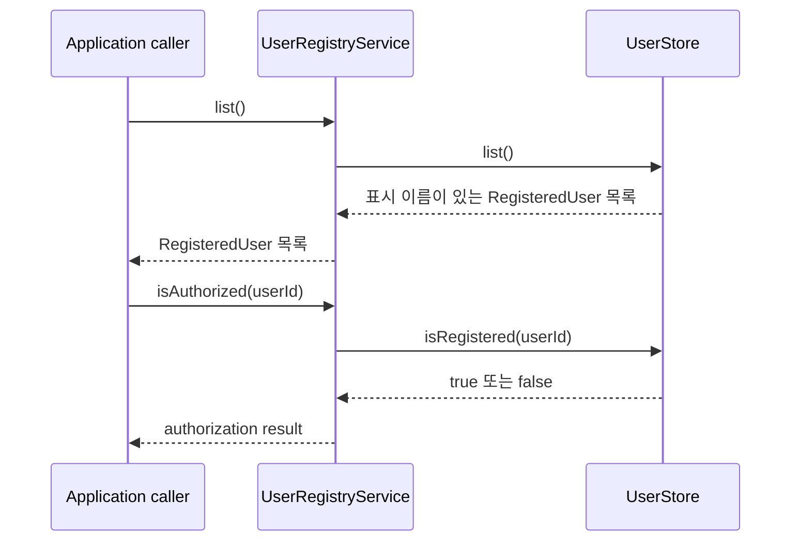
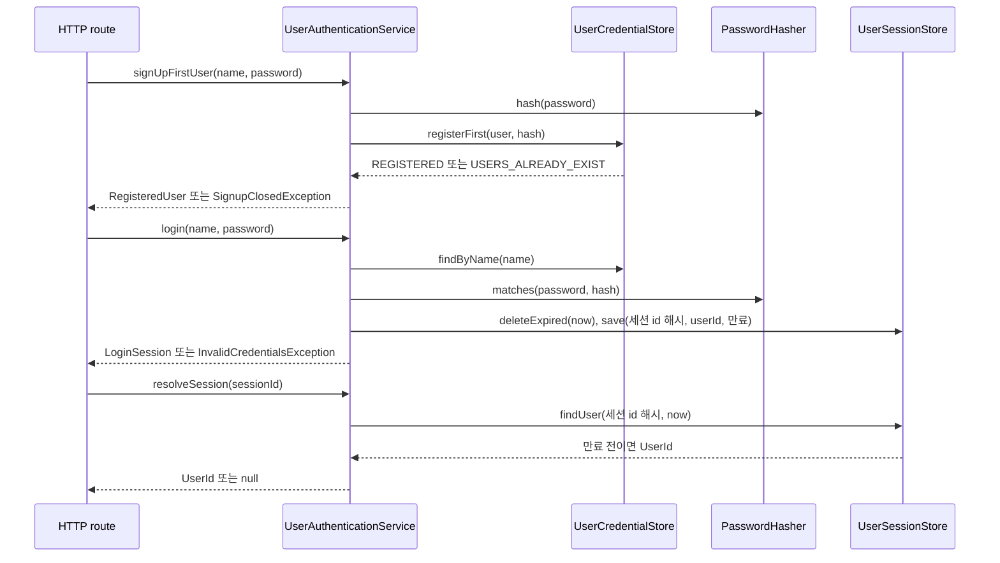

# Identity use case

`UserRegistryService`는 등록된 application 사용자 목록을 제공하는 `UserRegistry` input port이면서,
등록 여부를 판단하는 `UserAccessPolicy` 구현이기도 하다.

`UserAuthenticationService`는 이름과 비밀번호로 사용자를 등록하고 세션으로 로그인 상태를 유지하는
`UserAuthentication` input port다.

## 목록과 인가

## 등록과 로그인

## 규칙

- 표시 이름의 빈 값 금지와 50자 제한은 domain의 `RegisteredUser`가 소유한다.
- HTTP 인증·열람자 목록은 기존 application userId와 등록 사용자 목록을 사용한다.
- 첫 사용자는 사용자가 0명일 때만 스스로 가입한다. 이후 사용자는 로그인한 사용자가 이름과 초기 비밀번호로 추가한다.
- 이름은 유일하다. 비밀번호는 8자 이상이며 해시만 저장한다. 세션은 90일 뒤 만료되고 id의 해시만 저장한다.
- 기계 client는 비밀번호 대신 `HTTP_MEMBER_API_KEYS_JSON`의 Bearer key를 쓴다. key의 userId는 등록된 사용자여야 하며,
  아니면 서버가 시작하지 않는다. 그래서 사용자가 0명인 DB에서는 이 설정을 비워 두고 시작한다.
