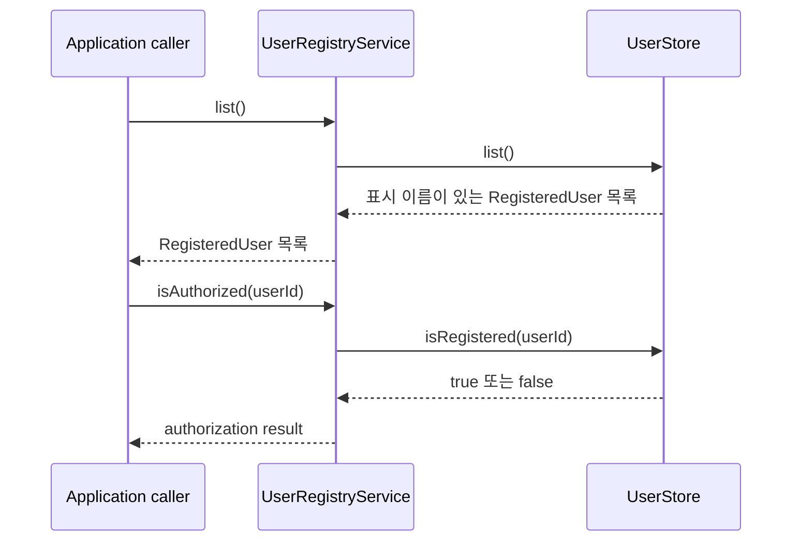

# Identity use case

`UserRegistryService`는 등록된 application 사용자 목록을 제공하는 `UserRegistry` input port이면서,
등록 여부를 판단하는 `UserAccessPolicy` 구현이기도 하다.

## 목록과 인가

## 규칙

- 표시 이름의 빈 값 금지와 50자 제한은 domain의 `RegisteredUser`가 소유한다.
- HTTP 인증·열람자 목록은 기존 application userId와 등록 사용자 목록을 사용한다.
- 사용자 등록 경로는 Slack 등록 흐름과 함께 제거했다. HTTP 사용자 provisioning은 아직 제공하지 않는다.
