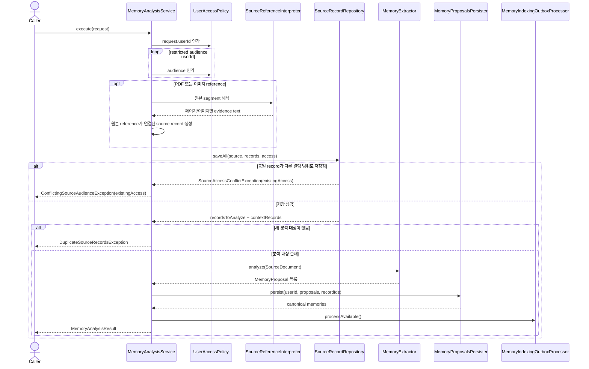

# Memory analysis use case

`MemoryAnalysisService`는 입력 source record를 저장하고, 새 분석 대상에서 memory proposal을 추출해
canonical memory로 즉시 확정한다. 별도의 preview/review 단계는 없다.

추출 계약은 독립적인 `content`와 `evidenceIds`만 갖는다. 모델 응답의 `text`와
`evidenceRecordIds`를 이 계약으로 변환하며, 고정된 정보 종류·대상 필드·확실성 enum을 요구하지
않는다. 대상, 발화자, 시점, 조건과 불확실성은 본문에 보존한다. 분야별 분류로 수집 범위를
제한하지 않으며, 원문에 없는 사실을 추가하거나 발언·추정을 확정된 사실로 바꾸지 않는다.
권한은 추출 모델이 판단하지 않고 근거 source의 immutable access에서 결정한다.

HTTP adapter가 인증된 principal의 application userId, source, access를 `MemoryAnalysis`에 직접 전달한다.
사용자 목록 조회는 공통 `UserRegistry`를 사용한다. 채널 identity 해석과 등록 대기 workflow는 없다.

## 분석과 저장

PDF·이미지 reference는 최대 20MB까지 받는다. PDF는 네 페이지 단위로 렌더링하고 이미지와 함께
추출 가능한 텍스트를 Codex에 제공하며, 이미지는 하나의 segment로 해석한다. 원본 binary는 SHA-256으로
중복 제거해 SQLite에 저장하고 각 해석 source record가 같은 reference를 가리킨다. 따라서 해석 record를
채택한 canonical memory evidence에서 원본 파일과 해당 segment 해석을 함께 추적할 수 있다. 원본과
해석 record는 요청에서 지정한 동일한 access scope를 상속한다.

## 실패 계약

- 등록되지 않은 작성자 또는 audience는 domain access exception/application audience exception으로 거절한다.
- 동일 source record가 다른 access scope로 이미 저장돼 있으면 기존 scope를 포함한
  `ConflictingSourceAudienceException`으로 변환하여 호출자가 정확한 재등록 방법을 안내할 수 있게 한다.
- source 저장, extraction, canonical commit 실패는 `MemoryAnalysisUnavailableException`으로 변환한다.
- 손상되었거나 지원하지 않는 reference는 `InvalidKnowledgeReferenceException`으로 변환한다.
- indexing 실패는 canonical commit을 취소하지 않으며 기존 outbox로 복구한다.
  Memory 저장 후 Topic 생성·배치는 호출하지 않는다. LM Topic 생성 경로와 worker는 제거했다.
