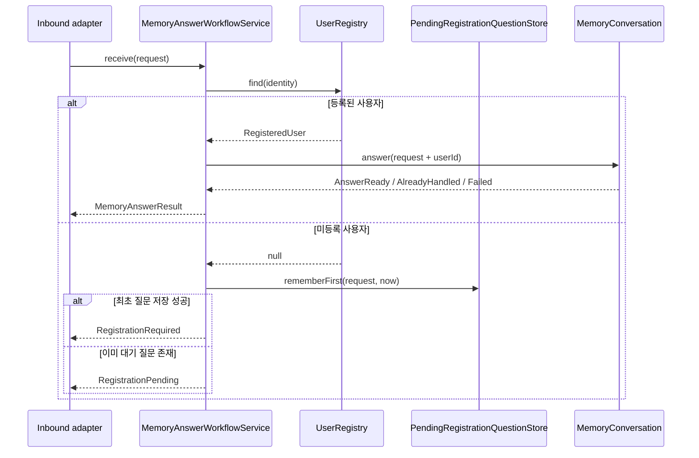
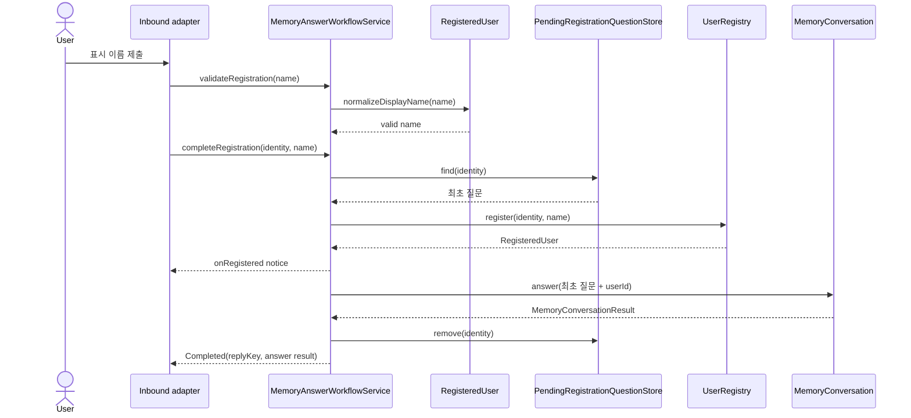
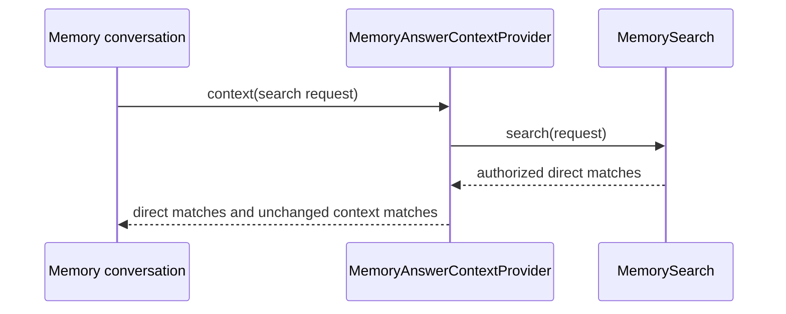

# Memory answer workflow

`MemoryAnswerWorkflowService`는 채널에 독립적인 사용자 등록 및 memory answer 진입점이다. Slack은
이 input port만 호출하며 `UserRegistry`, pending question, `MemoryConversation`을 직접 조합하지 않는다.

## 질문 접수

## 등록 완료와 최초 질문 재개

## Answer context

`MemoryAnswerContextProvider`는 현재 ACL로 허용된 Memory 직접 검색 결과를 순서와 근거 그대로
전달한다. Memory 자식 확장은 제거했으며 Topic 검색·추가 탐색은 후속 작업이다. 검색 실패는 기존
오류 계약을 유지하고, conversation reference 형식·최대 8,000자·session 재사용 정책은 바꾸지 않는다.

등록 안내 전송이 실패하면 inbound adapter가 `registrationPromptDeliveryFailed`를 호출한다. 동일한
pending key인 경우 저장 상태를 해제해 Slack 재전송 이벤트가 다시 등록 안내를 만들 수 있게 한다.
