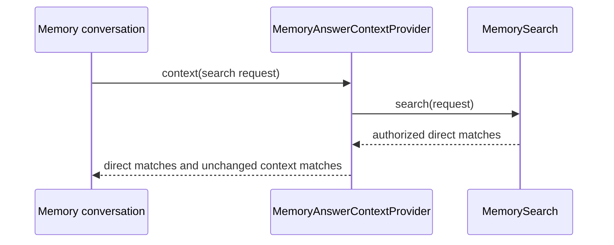

# Memory answer context

## Answer context

`MemoryAnswerContextProvider`는 현재 ACL로 허용된 Memory 직접 검색 결과를 순서와 근거 그대로
전달한다. Memory 자식 확장은 제거했으며 Topic 검색·추가 탐색은 후속 작업이다. 검색 실패는 기존
오류 계약을 유지하고, conversation reference 형식·최대 8,000자·session 재사용 정책은 바꾸지 않는다.

