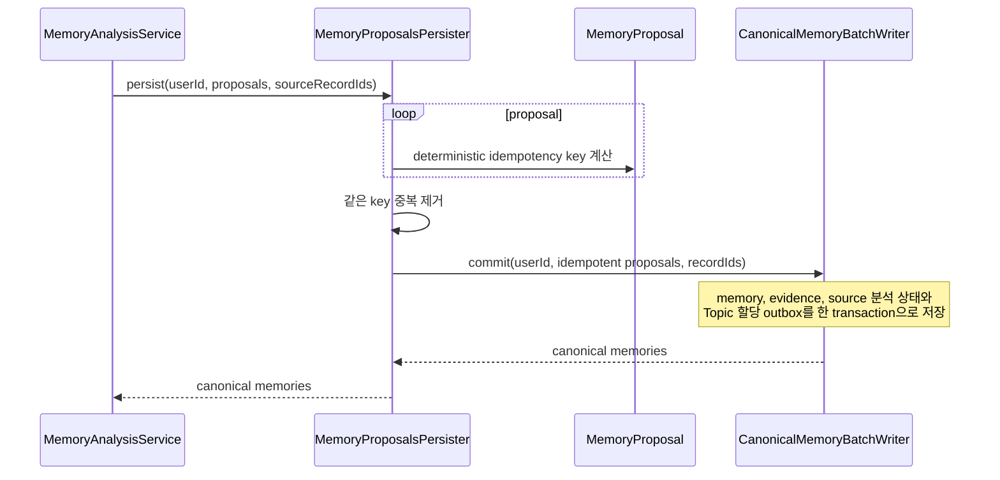

# Memory write use cases

이 패키지는 canonical memory를 원자적으로 확정한다. `MemoryProposalsPersister`가 원본 기록과
Topic 할당 outbox를 한 transaction으로 저장하고, outbox 처리는 [topic](../../topic/README.md)이 맡는다.

## Canonical memory commit

## 규칙

- idempotency key는 작성자, 앞뒤 공백을 제거한 content와 중복 제거·정렬한 evidence ID 전체를
  SHA-256으로 계산한다. 같은 내용이어도 작성자나 근거 집합이 다르면 별도 기록으로 보존한다.
- canonical commit과 outbox enqueue는 같은 transaction이어야 한다.

## 저장 모델

Memory는 ID, content, 근거, ACL, 등록자와 저장 시각을 보존한다. `memoryType`, `certainty`,
`subject`, Memory DB의 `updatedAt`과 `childrenIds`는 저장하지 않는다. 조직 관계는 Topic에서
관리하며 Memory 저장 transaction과 분리한다.

이 변경은 미배포 상태를 전제로 기존 필드·키에 대한 호환 migration을 제공하지 않는다.
기존 개발 DB는 자동 변환되지 않으며, 이전 스키마에는 더 이상 쓰지 않는 필수 열이 남아 새 저장이
실패할 수 있다. 사용 전 필요한 데이터를 보존하고 새 DB로 구성해야 한다. 코드 변경 자체는 DB를 초기화하지 않는다.
