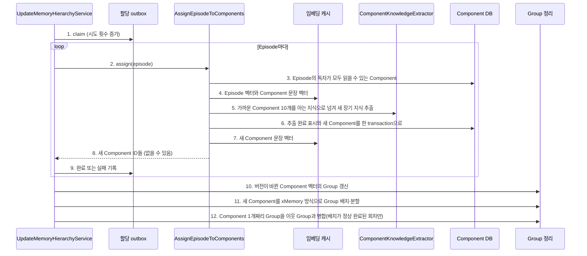
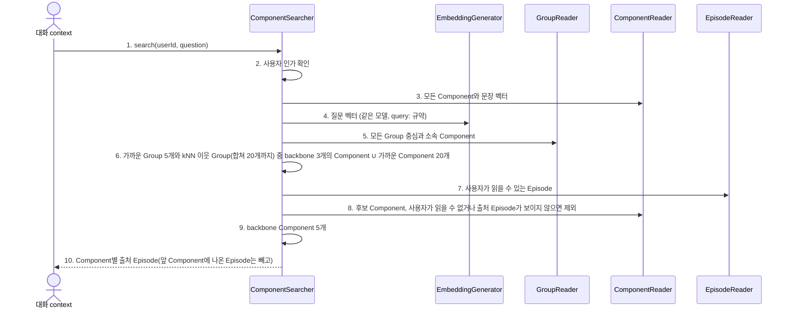

# Episode → Component extraction

Episode 하나에서 Component를 추출한다. `AssignEpisodeToComponents.assign(episode)`가 담당하며 inbound port가 아니다.
`assign`은 outbox를 모른다. outbox relay인 `UpdateMemoryHierarchyService`(`UpdateMemoryHierarchy`)가 Episode를 claim해 `assign`을 부르고 결과를 기록한다.
outbox 행은 Episode 저장 transaction에서 함께 생긴다. relay는 `isReady()`로 임베딩 runtime이 준비됐는지 확인한 뒤에만 claim하고,
claim 전에 outbox 도입 전 저장된 미추출 Episode를 등록한다. 앱의 worker는 이 use case를 주기마다 부르는 타이머다.
Group 배치(`OrganizeComponentIntoGroups`)와 병합(`MergeSmallGroups`)도 같은 use case가 이어서 부른다.

Episode는 xMemory의 episode, Component는 component, Group은 group이다. xMemory의 prediction-correction처럼
Episode에 가까운 기존 Component를 이미 아는 지식으로 두고, 그 지식이 말하지 않는 장기 지식만 새 Component로 저장한다.

## 정상 흐름

## 정책

- 아는 지식이 없으면 Episode 제목과 본문에서 장기 지식을 바로 뽑는다. 있으면 제목과 아는 지식만으로 Episode 내용을 예측한 뒤,
  원래 메시지와 비교해 예측에 없거나 틀린 장기 지식만 뽑는다. 프롬프트는 `ModelComponentKnowledgeExtractor`에 있다.
- 아는 지식은 Episode의 독자가 모두 읽을 수 있는 Component로 한정한다. 독자에게 숨겨진 지식이 그 독자의 추출에 영향을 주지 않게 하기 위해서다.
- Component는 문장 하나와 출처 Episode 하나를 가지며 바뀌지 않는다. 지식이 바뀌면 새 Component가 생기고 예전 것은 남는다.
- 접근 범위는 저장하지 않고 출처 Episode의 현재 접근 범위로 읽는다.
- 같은 문장이 여러 번 나오면 하나만 저장한다. 빈 문장은 버린다.
- 추출 대기는 outbox 행 상태로 판단한다. claim 시점에 이미 추출 표시가 있는 Episode는 추출하지 않고 완료 처리한다.
  그래서 Component 저장 직후 완료 기록 전에 중단돼도 같은 Episode가 두 번 추출되지 않는다.

## 실패·복구와 신뢰 경계

- 임베딩과 모델 호출은 DB transaction 밖에서 수행한다. 저장은 `ComponentMaintenanceStore.saveExtraction`의 원자 write다.
- `assign`이 실패하면 `UpdateMemoryHierarchyService`가 outbox에 시도 횟수와 오류를 남기고 다음 Episode를 계속 처리한다.
  실패한 Episode는 재시도 지연(기본 60초) 뒤 다시 claim되며, 최대 시도(기본 5회)를 넘으면 그 Episode만 멈춘다.
  처리 중 중단된 행은 lease(기본 10분)가 지나면 다시 claim된다.
- Group 배치·병합 단계의 오류는 그 회차를 멈춘다. 앞 단계의 저장 결과는 유지되고 다음 회차가 이어간다.
- 아는 지식은 매번 모든 Component 벡터와 비교해 고른다. 가족 규모를 전제로 하며 ANN 색인은 없다.
- Component 분할·병합(보류)은 [후속 작업](../../../../../../../../../docs/todolist/p1/component-group-merge-and-knn-links.md)이다.

## Component 검색

`ComponentSearcher`(`SearchComponents`)는 대화 context가 쓰는 검색이다. xMemory의 Stage I처럼 Group에서 들어가 Component로 좁힌다.

- backbone 선택은 domain의 `BackboneSelection`(xMemory 식 4)이며 Group과 Component 두 단계가 같은 것을 쓴다.
  아직 고르지 않은 후보 중 "새로 덮는 kNN 이웃 가중치 / 전체 가중치 + 질문 관련도"가 가장 큰 것을 차례로 고른다.
  관련도는 cosine을 0..1로 옮긴 값이다. 이웃은 그 계층 전체에서 가까운 10개이고, 덮음은 후보 안에서만 센다.
- 후보 Group에 가까운 Group의 kNN 이웃을 더한다. 질문과는 멀지만 질문과 닮은 Group 옆에 있는 맥락을 후보로 올리기 위해서다.
  관련도가 낮아서 coverage 이득이 클 때나 고를 수에 여유가 있을 때만 뽑힌다.
- 후보 Group은 논문의 Stage I 후보 풀처럼 20개까지다. 후보가 많으면 coverage를 나누는 전체 가중치가 커져 다양성 효과가 약해진다.
  남는 자리는 이웃 Group 중 이웃한 Group과 더 닮은 순으로 채운다. 질문과 닮은 순으로 자르면 확장하려던 맥락이 먼저 빠진다.
- kNN은 저장하지 않고 검색할 때 Group·Component 전체와 cosine으로 계산한다. 저장한 링크와 결과가 같고 낡지 않는다.
  Group·Component가 수만 개를 넘으면 같은 질의를 벡터 색인(pgvector)에 맡긴다.
- 가까운 Component를 직접 후보에 더하므로 아직 Group에 들어가지 않은 Component도 찾힌다.
- 한 Episode는 먼저 고른 Component 하나에만 싣는다. 출처 Episode가 앞 Component에 실린 Component는 결과에서 빠진다.
- Group 순위는 ACL과 무관한 중심으로 정한다. 그래서 순위에 남의 Component가 영향을 줄 수 있지만, 내용은 넘기지 않는다.
- 논문의 Stage II(reader entropy가 줄 때만 하위 텍스트 추가)는 하지 않는다([후속 작업](../../../../../../../../../docs/todolist/p2/xmemory-stage2-entropy.md)). 대화 context가 Episode를 순서대로 8,000자 안에서
  줄 단위로 싣는다. 최소 점수는 아직 두지 않는다.

검증은 fake port application 테스트와 임시 SQLite 통합 테스트를 사용한다. 실제 임베딩 서버는 호출하지 않는다.
