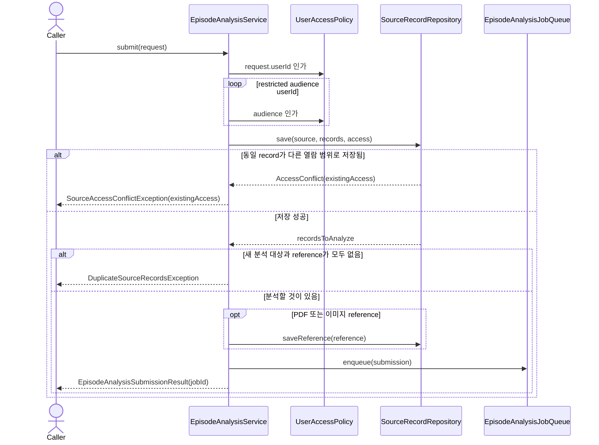
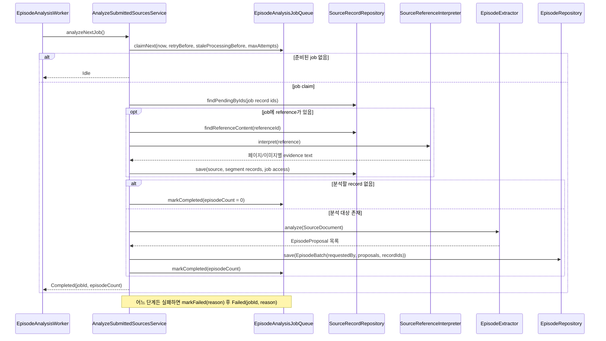

# Episode analysis use case

`EpisodeAnalysisService`는 입력 source record와 PDF·이미지 reference 원본을 저장하고 분석 job 하나를
`EpisodeAnalysisJobQueue`에 넣은 뒤 job id를 돌려준다. `AnalyzeSubmittedSourcesService`가 job을 하나씩 꺼내
reference를 해석하고, 아직 분석되지 않은 record에서 episode proposal을 추출해 canonical episode로 확정한다.
별도의 preview/review 단계는 없다.

추출 계약은 독립적인 `content`와 `evidenceIds`만 갖는다. 모델 응답의 `text`와
`evidenceRecordIds`를 이 계약으로 변환하며, 고정된 정보 종류·대상 필드·확실성 enum을 요구하지
않는다. 보낸 사람과 시각은 근거 source record에 남는다.
모델 입력에는 메시지 시각을 넣지 않는다. 분야별 분류로 수집 범위를 제한하지 않는다.
권한은 추출 모델이 판단하지 않고 근거 source의 immutable access에서 결정한다.

HTTP adapter가 인증된 principal의 application userId, source, access를 `EpisodeAnalysis.submit`에 직접 전달하고,
같은 사용자가 `EpisodeAnalysis.findJob`으로 job의 상태·episode 수·마지막 오류를 조회한다. 다른 사용자의 job은 찾지 못한다.
scheduler adapter의 `EpisodeAnalysisWorker`가 `AnalyzeSubmittedSources.analyzeNextJob`을 준비된 job이 없을 때까지
한 스레드에서 차례로 호출하므로 두 job이 동시에 분석되지 않는다. job이 없으면 10초 뒤 다시 확인한다.
사용자 목록 조회는 공통 `UserRegistry`를 사용한다. 채널 identity 해석과 등록 대기 workflow는 없다.

## 접수

## 분석 round

PDF·이미지 reference는 최대 20MB까지 받는다. PDF는 네 페이지 단위로 렌더링하고 이미지와 함께
추출 가능한 텍스트를 선택된 agent backend에 제공하며, 이미지는 하나의 segment로 해석한다. 원본 binary는 SHA-256으로
중복 제거해 SQLite에 저장하고 각 해석 source record가 같은 reference를 가리킨다. 따라서 해석 record를
채택한 canonical episode evidence에서 원본 파일과 해당 segment 해석을 함께 추적할 수 있다. 원본과
해석 record는 요청에서 지정한 동일한 access scope를 상속한다. job이 이 access를 함께 저장하므로 reference만
제출한 경우에도 worker가 해석 record를 같은 범위로 저장한다.

분석은 `integration-llm`의 `CompletionClient`로 실행한다. backend는 `AGENT_BACKEND`(`claude` 기본, `codex`)로
고르며, 어느 쪽이든 호출마다 일회성 세션에서 호출자가 준 output schema로 응답을 받고 요청 종료 시 임시 파일을
정리한다. backend별 모델·실행 제한과 CLI 설정은 `integration-llm`의 각 구현이 소유한다.

## 실패 계약

- 등록되지 않은 작성자는 `UserAccessDeniedException`, 등록되지 않은 열람 허용 사용자는 `InvalidAllowedUsersException`으로 거절한다.
- 동일 source record가 다른 access scope로 이미 저장돼 있으면 기존 scope를 포함한
  `SourceAccessConflictException`으로 변환하여 호출자가 정확한 재등록 방법을 안내할 수 있게 한다.
- 접수 중 source·reference 저장과 job 등록 실패는 `EpisodeAnalysisUnavailableException`으로 변환한다.
- record 저장과 job 등록은 별도 호출이다. 등록 전에 실패하면 record가 `PENDING`으로 남고, 같은 source를 다시
  제출하면 재시도 record로 돌아와 새 job에 담긴다.
- 분석 round의 실패(손상되었거나 지원하지 않는 reference, 빈 해석 결과, extraction, canonical commit)는 job에
  마지막 오류로 남긴다. 실패한 job은 60초 뒤부터 다시 claim되며 시도가 5회에 이르면 `FAILED`로 남는다. 처리 중인
  job이 10분 안에 끝나지 않으면 다른 round가 다시 claim하고, 이전 시도의 완료·실패 기록은 무시된다.
- Episode 저장 후 Component 배정을 직접 호출하지 않는다. commit에 함께 남긴 Component 할당 outbox를 worker가 처리한다.
