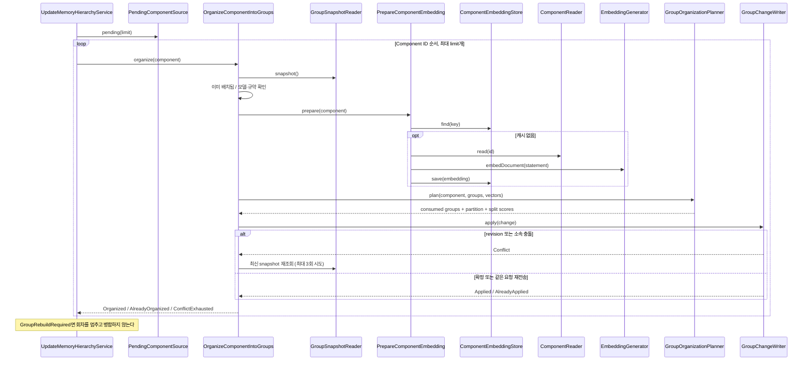

# Component → Group organization

명시적으로 저장된 Component를 component로 사용해 Group을 생성·배치·분할한다.
`OrganizeComponentIntoGroups.organize(component)`가 담당하며 inbound port가 아니다.
`UpdateMemoryHierarchyService`가 회차마다 아직 Group에 없는 Component(`PendingComponentSource`)를 읽어 하나씩 부른다.

## 책임과 정상 흐름

`OrganizeComponentIntoGroups`는 한 Component의 배치와 충돌 재시도, `PrepareComponentEmbedding`은 Component 벡터 버전과 규약에 맞는 벡터 재사용·생성을 담당한다.
Group은 Component ID와 벡터 버전만 받는다. 벡터는 캐시에 없을 때 `PrepareComponentEmbedding`이 `ComponentReader`로 문장을 읽어 `EmbeddingGenerator.embedDocument`로 만든다.
배치·분할 판단은 `domain/group/GroupOrganizationPlanner`가 순수 정책을 조합한다.
Application은 provider·DB 타입을 참조하지 않고 output port를 호출한다.

## 정책

- Component 벡터는 Component 문장을 document로 임베딩한 것이며 Episode 벡터, 질문 벡터와 같은 공간이다.
  벡터 버전은 문장의 fingerprint다. 문장은 바뀌지 않으므로 버전도 바뀌지 않는다.
- cosine이 attach threshold를 **초과**하면 가장 가까운 Group에 배치한다. 동점은 작은 Group ID다.
- 상한 초과 시 연결 성분과 결정적 이분할로 최대 두 종류의 partition 후보를 만든다.
- 각 후보를 동일 Component 집합과 동일한 주변 Group snapshot에서 평가한다.
- xMemory `SparsityScore + SemScore`를 사용한다. SparsityScore는 크기 균형이며 Group 수의 벌점이 아니다.
- 크기 제약을 만족하는 후보 중 점수가 높은 것을 선택한다. 동점이면 Group 수, Component ID 순이다.
- 점수가 개선되지 않아도 상한을 지키며 `GroupSplit.Divided.forced`와 before/after 점수를 반환한다.
- 분할 시 최소 Component ID를 가진 조각이 기존 Group ID를 유지한다.
- 정책은 `GroupPolicySettings(attachThreshold=0.6, maxComponents=12, splitThreshold=0.65, mergeThreshold=0.65, mergeNeighbors=10)`로 조정한다.
  앱 factory의 `groupSettings` 인자로 주입하며 환경변수 해석을 domain에 넣지 않는다.

이분할 fallback은 원본 PCA fallback의 단순화다. 분할은 이번에 추가한 Component의 대상 Group에만
적용한다. 설정 상한을 낮춘 뒤 기존 Group 전체를 일괄 정리하는 기능은 없다.
Group 요약·kNN 검색·entropy 기반 원문 확장은 구현하지 않는다.

## Group 병합

`MergeSmallGroups`는 `UpdateMemoryHierarchyService`가 회차마다 Group 배치 다음에 부른다. 배치 중 `GroupRebuildRequired`가 나면 그 회차에는 실행하지 않는다. 규칙은 xMemory 부록 A.2·B를 따른다.

- Component가 1개뿐인 Group을 ID 순으로 본다.
- 중심이 가까운 Group `mergeNeighbors`(10)개 중 중심 cosine이 `mergeThreshold`(0.65) 이상이고 합쳐도 `maxComponents` 이하인 것이 후보다.
  합친 크기 상한은 논문에 없지만, 넘으면 곧바로 분할 조건에 걸리므로 둔다.
- 후보마다 전체 Group의 식 (1)을 계산해 개선 폭이 가장 큰 Group과 합친다. 개선이 없으면 합치지 않는다. 동점이면 가까운 Group이다.
- 작은 ID가 남는다. 저장은 기존 `GroupChange`의 N→1 형태다. 매번 snapshot을 다시 읽어 한 건씩 처리하고, 합칠 Group이 없거나 충돌이 3회 나면 멈춘다.
  merge마다 Group이 하나 줄어서 루프는 반드시 끝난다.
- Group 벡터 갱신 뒤에 실행해야 한다. Group이 Component의 현재 중심보다 예전 벡터를 들고 있으면 점수가 틀리므로, 그런 Component가 있으면 예외를 던진다.

## 실패·복구와 신뢰 경계

- 임베딩과 모든 정책 계산은 DB transaction 밖에서 수행한다.
- 캐시는 Component ID·벡터 버전·모델·입력 규약으로 구분한다. 같은 key는 첫 저장 벡터를 재사용한다.
- 유한하지 않은 값·영벡터·차원 불일치·계산 불가능한 centroid는 성공으로 처리하지 않는다.
- Group 소속·centroid·revision·receipt는 한 transaction으로 확정한다. 실패 시 모두 롤백한다.
- 모델·규약·차원이 바뀌면 `GroupRebuildRequired`를 던지고, `UpdateMemoryHierarchyService`는 그 회차의 배치를 멈추고 병합하지 않는다. Component 문장은 바뀌지 않으므로 이미 배치된 Component의
  벡터 버전도 바뀌지 않는다.
  모델 이름이 같아도 실제 가중치를 교체했다면 식별자를 변경해야 한다. 자동 재구성은 후속 작업이다.
- 개별 Component 실패는 `UpdateMemoryHierarchyService`가 그 Component만 `Failed`로 남기고, 충돌 3회 소진은 `ConflictExhausted`다. 뒤의 독립 Component는 계속 처리한다.
  취소 예외는 삼키지 않는다. Pending 조회 자체의 저장소 장애는 호출자에게 전파한다.
- 저장 성공 후 호출이 중단되어도 다음 실행은 Group 미소속 Component만 조회한다.
  저장 요청 자체를 재전송할 때에는 같은 operation key와 내용을 사용하면 같은 ID를 받는다.
- 재시작 시 자동 실행하지 않는다. 다음 명시적 호출로 미처리를 이어간다. 영구 실패 Component가 반복
  batch 앞부분을 차지하는 문제의 backoff·격리 및 worker는 후속 범위다.
- 전체 Group snapshot을 읽으며 점수 계산은 Group 수에 따라 증가한다. ANN·증분 최적화는 없다.
- 다른 Group의 동시 변경 때문에 점수가 오래된 기준일 수 있지만 대상 소속을 덮어쓰지 않는다.
- 혼합 ACL 메타데이터는 trusted internal 전용이다. 사용자 응답·검색에 직접 전달하지 않는다.
  Group 소속은 열람 권한을 부여하지 않으며 Component·Episode·Source·ACL은 변경하지 않는다.

검증은 고정 벡터 domain 테스트, fake port application 테스트, 임시 SQLite 통합 테스트를 사용한다.
실제 임베딩 서버나 운영 서비스를 시작하지 않는다. 검색 품질과 한국어 임계값은 아직 검증되지 않았다.
