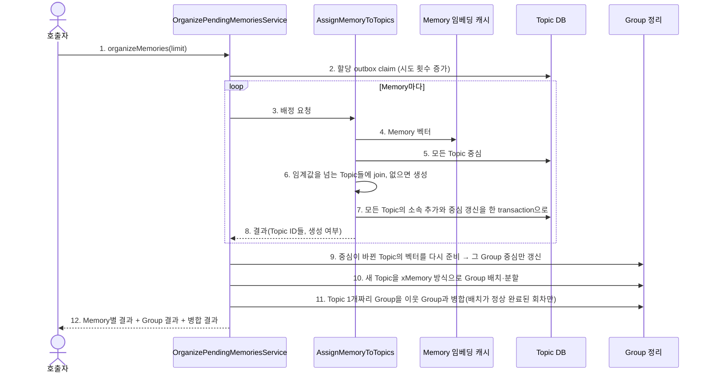
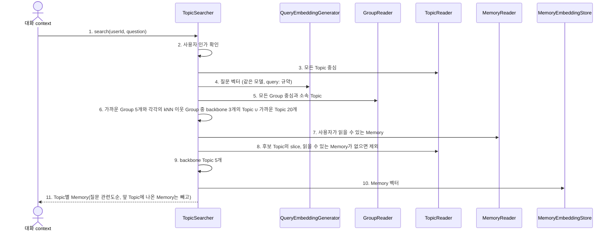

# Memory → Topic assignment

Topic 할당 outbox에 쌓인 Memory를 가까운 Topic들에 배정하고, 이어서 Topic을 Group으로 정리한다.
내부 input port는 `OrganizePendingMemories.execute(limit)`이며 앱의 `organizeMemories`로 제공된다.
outbox 행은 Memory 저장 transaction에서 함께 생긴다. 앱의 Topic 할당 worker가 주기마다 임베딩 runtime이
준비됐는지 확인한 뒤에만 호출한다. 준비되지 않은 회차는 claim하지 않는다.
worker는 시작 시 `enqueueUnassigned()`로 outbox 도입 전 저장된 미할당 Memory를 한 번 등록한다.

Topic은 xMemory의 component에 해당한다. xMemory가 segment를 component 중심과의 cosine으로 붙이거나
새 component를 만들듯, Memory는 Topic 중심과의 cosine으로 가까운 Topic들에 합류하거나 새 Topic을 만든다.
Topic 위의 Group은 xMemory의 group이다. 대응이 1:1은 아니다.

## 정상 흐름

## 정책

- 한 Memory는 여러 Topic에 속할 수 있다. `TopicPlacementPolicy`는 cosine 0.8(`joinAllThreshold`) 이상인 Topic을 전부 고르고,
  그것이 3개(`fillUpTo`) 미만이면 0.6(`joinThreshold`) 이상인 Topic으로 가까운 순으로 3개까지 채운다. 동점은 작은 Topic ID다.
  0.6 이상이 없으면 새 Topic을 만든다.
- 중심은 소속 Memory 벡터의 합으로 저장하므로 join은 벡터 하나를 더하면 되고 전체 소속을 다시 읽지 않는다.
- join은 고른 Topic마다 읽은 시점의 Memory 수를 조건으로 쓰고, 전부를 한 transaction으로 쓴다. 그사이 어느 Topic에든 다른 join이
  있었다면 아무것도 쓰지 않고 그 Memory는 `Failed`가 되며 outbox가 다시 시도한다. 그래서 일부 Topic에만 속한 상태는 생기지 않는다.
- Topic에는 설명·분류명이 없다. ACL별 slice는 Memory의 현재 접근 범위로 읽을 때 나눈다.
- 배정 대기는 outbox 행 상태로 판단한다. claim 시점에 이미 Topic 소속이 있는 Memory는 배정하지 않고 완료 처리한다.
  그래서 Topic 저장 직후 완료 기록 전에 중단돼도 같은 Memory가 두 번 배정되지 않는다.

## 실패·복구와 신뢰 경계

- 임베딩은 DB transaction 밖에서 수행한다. 저장은 `TopicMaintenanceStore`의 원자 write다.
- 개별 Memory 실패는 `Failed`이며 outbox에 시도 횟수와 오류를 남기고 다음 Memory를 계속 처리한다.
  실패한 Memory는 재시도 지연(기본 60초) 뒤 다시 claim되며, 최대 시도(기본 5회)를 넘으면 그 Memory만 멈춘다.
  처리 중 중단된 행은 lease(기본 10분)가 지나면 다시 claim된다.
- Group 벡터 준비·배치 단계의 오류는 호출자에게 전파한다. 앞 단계의 저장 결과는 유지되고 다음 호출이 이어간다.
- Topic 중심은 ACL이 다른 Memory를 함께 담는다. 검색은 중심으로 순위만 정하고, 사용자에게는 읽을 수 있는 slice의 Memory만 넘긴다.
- 할당은 매번 전체 Topic 중심을 비교한다. 가족 규모를 전제로 하며 ANN 색인은 없다.
- Topic 분할·병합(보류)은 [후속 작업](../../../../../../../../../docs/todolist/p1/topic-group-merge-and-knn-links.md)이다.

## Topic 검색

`TopicSearcher`(`SearchTopics`)는 대화 context가 쓰는 검색이다. xMemory의 Stage I처럼 Group에서 들어가 Topic으로 좁힌다.

- backbone 선택은 domain의 `BackboneSelection`(xMemory 식 4)이며 Group과 Topic 두 단계가 같은 것을 쓴다.
  아직 고르지 않은 후보 중 "새로 덮는 kNN 이웃 가중치 / 전체 가중치 + 질문 관련도"가 가장 큰 것을 차례로 고른다.
  관련도는 cosine을 0..1로 옮긴 값이다. 이웃은 그 계층 전체에서 가까운 10개이고, 덮음은 후보 안에서만 센다.
- 후보 Group에 가까운 Group의 kNN 이웃을 더한다. 질문과는 멀지만 질문과 닮은 Group 옆에 있는 맥락을 후보로 올리기 위해서다.
  관련도가 낮아서 coverage 이득이 클 때나 고를 수에 여유가 있을 때만 뽑힌다.
- kNN은 저장하지 않고 검색할 때 Group·Topic 전체와 cosine으로 계산한다. 저장한 링크와 결과가 같고 낡지 않는다.
  Group·Topic이 수만 개를 넘으면 같은 질의를 벡터 색인(pgvector)에 맡긴다.
- 가까운 Topic을 직접 후보에 더하므로 아직 Group에 들어가지 않은 Topic도 찾힌다.
- 한 Memory는 먼저 고른 Topic 하나에만 싣는다. Memory가 모두 앞 Topic에 실린 Topic은 결과에서 빠진다.
- Group·Topic 순위는 ACL과 무관한 중심으로 정한다. 그래서 순위에 남의 Memory가 영향을 줄 수 있지만, 내용은 넘기지 않는다.
- 논문의 Stage II(reader entropy가 줄 때만 하위 텍스트 추가)는 하지 않는다([후속 작업](../../../../../../../../../docs/todolist/p2/xmemory-stage2-entropy.md)). 대화 context가 Memory를 순서대로 8,000자 안에서
  줄 단위로 싣는다. 최소 점수는 아직 두지 않는다.

## Topic 설명

`TopicDescriber`(`DescribeTopic`)는 사람이 읽는 Topic 설명을 조회자마다 만든다. 설명은 Topic에 저장하지 않는
재생성 가능한 read model이다. Topic은 계속 중심 벡터와 ACL slice만 가진다.

1. 사용자 인가를 확인하고 Topic을 읽는다. 없거나 읽을 수 있는 slice가 없으면 `Hidden`이다. 둘을 구분하지 않는다.
2. 열람 범위(`TopicView`)는 PUBLIC slice와 조회자가 포함된 slice의 합이다. 같은 slice를 읽는 조회자는 같은 범위다.
3. 캐시 key는 (Topic ID, 범위의 slice 집합)이다. 권한이 바뀌면 slice 집합이 달라져 이전 설명을 쓰지 않는다.
4. 캐시에는 설명을 쓸 때의 slice별 Memory 수(slice 버전)를 함께 둔다. `TopicDescriptionRefreshPolicy`가 재생성을 정한다.
   - 캐시가 없거나, 어떤 slice의 Memory가 줄었으면 재생성한다.
   - 범위의 Memory가 설명을 쓴 시점보다 `growthThreshold`(기본 0.2, 20%) 이상 늘었으면 재생성한다.
   - 그 밖에는 이전 설명을 그대로 보여준다.
5. 재생성 입력은 범위의 Memory 중 `MemoryReader`가 조회자에게 보여주는 것뿐이며 최신순이다. LM 결과를 저장하고 돌려준다.

- 미리 만들지 않는다. 설명이 필요한 요청이 올 때만 LM을 호출한다.
- LM·저장 실패는 호출자에게 전파한다. 캐시가 없어지면 다음 요청이 다시 만든다.
- 같은 범위를 동시에 처음 열면 LM이 두 번 불릴 수 있고 나중 결과가 남는다. 가족 규모라 잠금은 두지 않는다.

검증은 fake port application 테스트와 임시 SQLite 통합 테스트를 사용한다. 실제 임베딩 서버는 호출하지 않는다.
