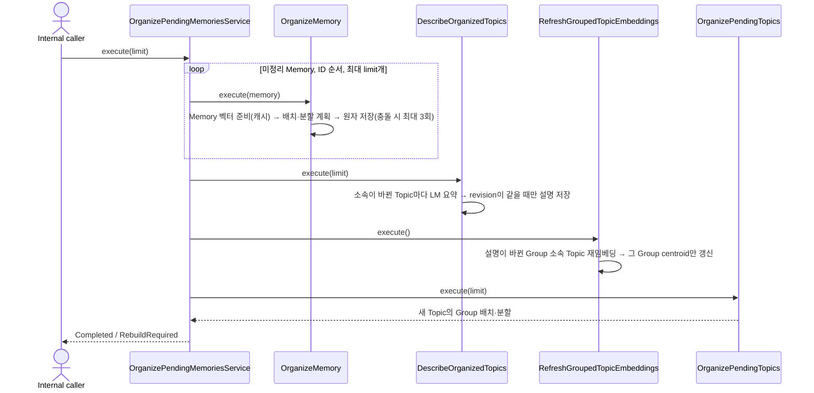

# Memory → Topic organization

xMemory 방식으로 Memory를 Topic에 배치·분할하고 Topic 설명을 LM 요약으로 만든 뒤 Group 정리까지 이어서 실행한다.
내부 input port는 `OrganizePendingMemories.execute(limit)`이며 앱의 `organizeMemories`로 제공된다.
HTTP·worker·Memory 분석 경로에서는 호출하지 않는다. 앱 시작만으로 실행되지 않는다.

## 정상 흐름

## 정책

- 배치·분할은 Group과 같은 `GroupOrganizationPlanner`를 Memory ID와 Memory 벡터에 적용한다.
  cosine이 0.6을 **초과**하면 가장 가까운 Topic에 붙이고, 12개를 넘으면 0.65 연결 성분·이분할 후보를 조직 점수로 비교한다.
  앱 factory의 `topicSettings`로 조정한다.
- 분할 시 가장 작은 Memory ID를 가진 조각이 기존 Topic ID를 유지한다. Topic은 삭제·병합하지 않는다.
- Memory 벡터는 `memory-content:passage:v1` 규약으로 만들고 Memory ID·내용 SHA-256·모델·규약으로 캐시한다.
- 정리된 소속은 Topic 분류 `기본`에 저장한다. xMemory에는 분류가 없다.
- 새 Topic은 가장 작은 Memory 내용을 임시 설명으로 가진다. 소속 revision이 바뀐 Topic은 같은 실행의 요약 단계에서
  LM이 설명을 다시 만든다. 소속 변경마다가 아니라 실행마다 Topic당 한 번 요약한다.
- 수동으로 저장한 Topic(`TopicMaintenanceStore`)은 정리 대상이 아니다. 같은 Topic의 다른 분류 소속도 바꾸지 않는다.

## 실패·복구와 신뢰 경계

- 임베딩·계획·LM 호출은 DB transaction 밖에서 수행한다. 소속·centroid·revision·Topic 생성은 한 transaction이다.
- 개별 Memory 실패는 `Failed`, 충돌 3회 소진은 `ConflictExhausted`이며 다음 Memory를 계속 처리한다.
- Memory 벡터 모델·규약·차원이 바뀌면 `RebuildRequired`로 이후 단계를 실행하지 않는다.
- 요약 대기는 `described_revision`으로 저장되므로 중단·LM 실패 후 다음 호출이 이어서 요약한다.
  요약 중 소속이 바뀌면 `Superseded`로 보고하고 다음 호출이 새 revision을 요약한다.
- Group 재임베딩·배치 단계의 임베딩 장애는 호출자에게 전파한다. 앞 단계의 저장 결과는 유지되고 다음 호출이 이어간다.
- LM은 ACL이 다른 Memory 내용을 함께 읽는다. Topic 설명은 trusted internal 메타데이터이며 사용자 검색·응답에 아직 연결하지 않는다.
- Topic 병합, Topic kNN 링크, 검색 연결, 한국어 임계값 검증은 구현하지 않았다.

검증은 fake port application 테스트와 임시 SQLite 통합 테스트를 사용한다. 실제 LM·임베딩 서버는 호출하지 않는다.
