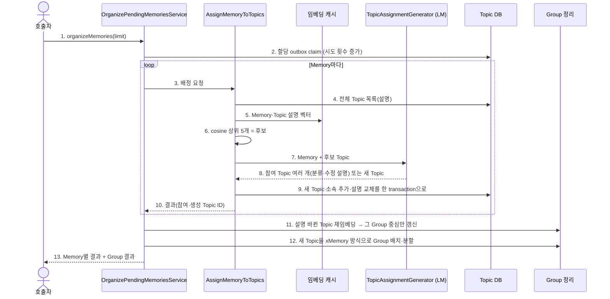

# Memory → Topic assignment

Topic 할당 outbox에 쌓인 Memory를 하나 이상의 Topic에 배정하고, 이어서 Topic을 Group으로 정리한다.
내부 input port는 `OrganizePendingMemories.execute(limit)`이며 앱의 `organizeMemories`로 제공된다.
outbox 행은 Memory 저장 transaction에서 함께 생긴다. 앱의 Topic 할당 worker가 주기마다 임베딩 runtime과
agent backend CLI가 준비됐는지 확인한 뒤에만 호출한다. 준비되지 않은 회차는 claim하지 않는다.
worker는 시작 시 `enqueueUnassigned()`로 outbox 도입 전 저장된 미할당 Memory를 한 번 등록한다.

xMemory 대응은 Source가 segment, Memory가 component, Group이 group이다. Topic은 xMemory에 없는 층으로,
한 Memory가 여러 묶음에 속하는 복수 소속을 담는다. Group의 xMemory 분할은 한 원소가 한 group에만
속한다고 가정하므로, 겹침은 Topic이 맡고 분할은 Topic 위의 Group이 맡는다.

## 정상 흐름

## 정책

- 한 Memory는 여러 Topic에 속할 수 있다. 모델은 후보 중 해당하는 Topic을 모두 고르고, 없으면 새 Topic을 만든다.
  최소 한 Topic에는 배정한다. 후보가 아닌 Topic ID를 고르면 그 Memory는 `Failed`다.
- Memory가 참여한 Topic은 소속이 바뀌었으므로 모델이 낸 수정 설명으로 같은 batch에서 교체한다.
  전체 소속을 다시 읽지 않고 기존 설명과 새 Memory로 갱신하므로 Topic 크기와 무관하게 호출이 한 번이다.
- 분류명은 모델이 Topic 안에서 정한다. 새 Topic의 creation key는 `memory:{memoryId}:{순번}`이다.
- Memory 벡터는 `memory-content:passage:v1`, Topic 벡터는 `topic-description:passage:v1` 규약이며 같은 모델을 쓴다.
- 배정 대기는 outbox 행 상태로 판단한다. claim 시점에 이미 Topic 소속이 있는 Memory는 배정하지 않고 완료 처리한다.
  그래서 Topic 저장 직후 완료 기록 전에 중단돼도 같은 Memory가 두 번 배정되지 않는다.

## 실패·복구와 신뢰 경계

- 임베딩·모델 호출은 DB transaction 밖에서 수행한다. 저장은 `TopicMaintenanceStore`의 원자 batch다.
- 개별 Memory 실패는 `Failed`이며 outbox에 시도 횟수와 오류를 남기고 다음 Memory를 계속 처리한다.
  실패한 Memory는 재시도 지연(기본 60초) 뒤 다시 claim되며, 최대 시도(기본 5회)를 넘으면 그 Memory만 멈춘다.
  처리 중 중단된 행은 lease(기본 10분)가 지나면 다시 claim된다.
- Group 재임베딩·배치 단계의 임베딩 장애는 호출자에게 전파한다. 앞 단계의 저장 결과는 유지되고 다음 호출이 이어간다.
- 모델은 ACL이 다른 Memory로 만든 Topic 설명을 후보로 읽는다. Topic 설명은 trusted internal 메타데이터이며
  사용자 검색·응답에 아직 연결하지 않는다.
- 후보 검색은 매번 전체 Topic 벡터를 비교한다. 가족 규모를 전제로 하며 ANN 색인은 없다.
- Topic 분할, Topic·Group 병합과 kNN 링크는 [후속 작업](../../../../../../../../../docs/todolist/p1/topic-group-merge-and-knn-links.md)이다.
  검색 연결과 한국어 품질 검증도 구현하지 않았다.

검증은 fake port application 테스트와 임시 SQLite 통합 테스트를 사용한다. 실제 LM·임베딩 서버는 호출하지 않는다.
