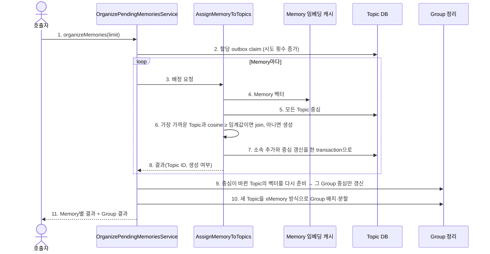

# Memory → Topic assignment

Topic 할당 outbox에 쌓인 Memory를 Topic 하나에 배정하고, 이어서 Topic을 Group으로 정리한다.
내부 input port는 `OrganizePendingMemories.execute(limit)`이며 앱의 `organizeMemories`로 제공된다.
outbox 행은 Memory 저장 transaction에서 함께 생긴다. 앱의 Topic 할당 worker가 주기마다 임베딩 runtime이
준비됐는지 확인한 뒤에만 호출한다. 준비되지 않은 회차는 claim하지 않는다.
worker는 시작 시 `enqueueUnassigned()`로 outbox 도입 전 저장된 미할당 Memory를 한 번 등록한다.

Topic은 xMemory의 component에 해당한다. xMemory가 segment를 component 중심과의 cosine으로 붙이거나
새 component를 만들듯, Memory는 가장 가까운 Topic 중심과의 cosine으로 Topic에 합류하거나 새 Topic을 만든다.
Topic 위의 Group은 xMemory의 group이다. 대응이 1:1은 아니다.

## 정상 흐름

## 정책

- 한 Memory는 Topic 하나에만 속한다. 임계값은 `TopicPlacementPolicy(joinThreshold=0.6)`이며 동점은 작은 Topic ID다.
- 중심은 소속 Memory 벡터의 합으로 저장하므로 join은 벡터 하나를 더하면 되고 전체 소속을 다시 읽지 않는다.
- join은 읽은 시점의 Memory 수를 조건으로 쓴다. 그사이 다른 join이 있었다면 그 Memory는 `Failed`가 되고
  outbox가 다시 시도한다.
- Topic에는 설명·분류명이 없다. ACL별 slice는 Memory의 현재 접근 범위로 읽을 때 나눈다.
- 배정 대기는 outbox 행 상태로 판단한다. claim 시점에 이미 Topic 소속이 있는 Memory는 배정하지 않고 완료 처리한다.
  그래서 Topic 저장 직후 완료 기록 전에 중단돼도 같은 Memory가 두 번 배정되지 않는다.

## 실패·복구와 신뢰 경계

- 임베딩은 DB transaction 밖에서 수행한다. 저장은 `TopicMaintenanceStore`의 원자 write다.
- 개별 Memory 실패는 `Failed`이며 outbox에 시도 횟수와 오류를 남기고 다음 Memory를 계속 처리한다.
  실패한 Memory는 재시도 지연(기본 60초) 뒤 다시 claim되며, 최대 시도(기본 5회)를 넘으면 그 Memory만 멈춘다.
  처리 중 중단된 행은 lease(기본 10분)가 지나면 다시 claim된다.
- Group 벡터 준비·배치 단계의 오류는 호출자에게 전파한다. 앞 단계의 저장 결과는 유지되고 다음 호출이 이어간다.
- Topic 중심은 ACL이 다른 Memory를 함께 담는 trusted internal 메타데이터이며 사용자 검색·응답에 아직 연결하지 않는다.
- 할당은 매번 전체 Topic 중심을 비교한다. 가족 규모를 전제로 하며 ANN 색인은 없다.
- Topic 분할, Topic·Group 병합과 kNN 링크는 [후속 작업](../../../../../../../../../docs/todolist/p1/topic-group-merge-and-knn-links.md)이다.

검증은 fake port application 테스트와 임시 SQLite 통합 테스트를 사용한다. 실제 임베딩 서버는 호출하지 않는다.
