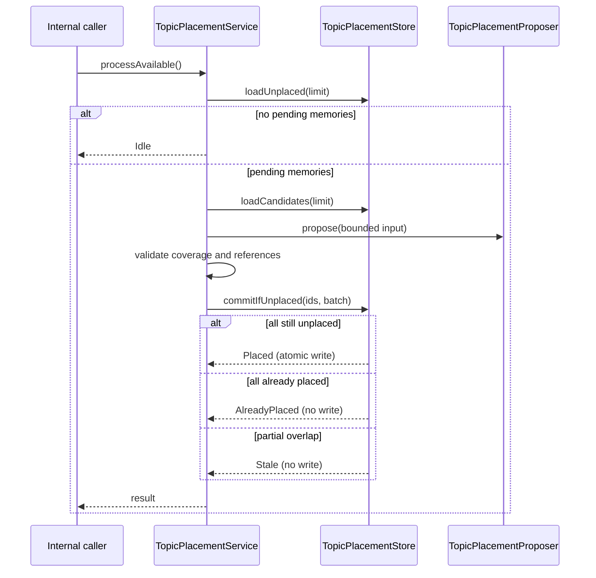

# Topic placement use case

`TopicPlacementService`는 사용자 응답과 분리된 내부 정리 작업이다. 아직 Topic 소속이 없는
canonical Memory를 기본 20개씩 읽고, 최근 Topic 설명 최대 20개를 후보로 제공한다. 후보는
의미 검색 결과가 아니므로 범위 밖의 유사 Topic을 놓칠 수 있다. Topic 검색은 후속 작업이다.

입력 작성자가 restricted audience에 포함되지 않아도 저장된 Memory를 정리할 수 있다. 이 내부
권한은 사용자에게 전달되지 않으며 후보 설명·배치 결과를 사용자 조회나 답변 context에 사용하지 않는다.

모든 입력 Memory는 한 번 이상 소속되어야 한다. 입력 밖의 Memory, 후보 밖의 Topic, 선언하지 않은
신규 Topic, 소속이 없는 신규 Topic, 자기 연결을 거절한다. 복수 소속과 순환은 허용한다.
신규 Topic key에는 입력 Memory ID 집합을 접두어로 붙인다. 검증은 작업을 결정하고 저장 port가
실제로 반영한다. 모델 호출은 DB transaction 밖에서 이루어진다.

조회·모델 제안·검증·저장 실패는 `Failed(stage)`로 구분하며 취소는 전파한다. 실패한 batch는
아무 소속도 저장하지 않으므로 다음 실행에서도 조회된다. 저장 직전 존재·미배치 상태를 같은
transaction에서 다시 확인해 겹친 실행이 Topic을 중복 생성하지 않게 한다. 저장 후 응답 전에
중단되어도 이미 소속된 Memory는 다음 조회에서 제외된다.

별도 배치 outbox 없이 canonical Memory와 소속 유무를 복구 기준으로 사용한다. 기존 Memory 색인
outbox는 변경하지 않는다. `processAvailable()`은 분석 저장 직후와 앱의 `TopicPlacementWorker`에서
호출한다. worker는 시작 시 즉시 실행하고, 한 실행이 끝난 뒤 30초 간격으로 반복한다. 종료 시
실행 중인 coroutine을 취소한다. 같은 batch가 계속 실패하면 반복 선택될 수 있으며 자동 격리·분할은 현재 제공하지 않는다.
기존 소속 재정리나 Topic 설명 수정은 이 초기 배치 작업의 범위가 아니다.

모델 adapter는 입력을 지시문과 분리한 JSON으로 전달하고 기존 Topic은 `existing:<id>`, 신규
Topic은 `new:<key>`로 변환한다. JSON 형식·참조 표현 오류는 adapter가, 실제 후보 범위와 배치
완전성은 application이 검증한다. 입력 32,000자·응답 64,000자를 넘으면 자르지 않고 실패한다.
model prompt·응답 크기 제한은 이 단계의 운영 한도이며 전체 검색 품질 보장을 뜻하지 않는다.
