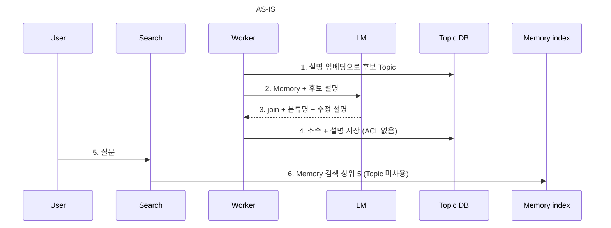
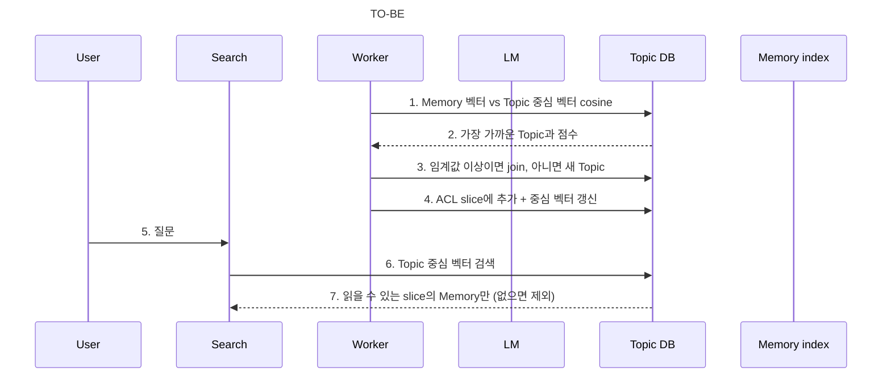

# Topic 중심 벡터·ACL slice와 Topic 검색

- 상태: VERIFY — 실데이터로 임계값 조정과 실제 서버 확인 남음
- 우선순위: P1 (검색 연결 시 프라이버시 영향)
- 선행 작업: [Topic 할당 outbox와 worker](topic-assignment-outbox.md)

## 문제

- Topic 설명과 분류명은 LM이 ACL이 섞인 Memory로 다시 쓴 글이다. 검색에 연결하면 비공개 내용이 다른 사용자에게 보일 수 있다.
- 대화 context는 Memory 벡터 검색 상위 5건뿐이다(`MemoryConversationContextProvider.MAX_MATCHES`). 같은 주제의 비슷한 Memory가
  상위를 채워 검색 품질이 낮다.
- Memory 하나를 할당할 때마다 LM 호출이 1회 생긴다.

## 결정 (2026-10-20 스레드 합의)

- Topic을 xMemory의 component로 본다. 완전한 1:1 대응은 아니다.
- Topic은 **중심 벡터**와 **ACL별 Memory 목록(slice)**만 가진다. 설명·분류명 등 LM이 쓰는 글은 두지 않는다.
- Topic에 ACL이 있다. slice 하나는 같은 ACL(`PUBLIC` 또는 열람자 집합)을 가진 소속 Memory 목록이며, slice의 ACL은 그 Memory들의 ACL과 같다.
- 할당은 LM 없이 cosine 유사도로 한다. 가장 가까운 Topic 하나와의 유사도가 임계값 이상이면 join, 아니면 새 Topic을 만든다.
  Memory는 Topic 하나에만 속한다. (2026-10-21 복수 소속으로 변경: [usecase/topic README](../../../application/src/main/kotlin/com/homeassistant/application/usecase/topic/README.md))
- 검색 단위는 Topic이다. 질문 임베딩으로 Topic 중심 벡터를 검색하고, 사용자가 읽을 수 있는 slice의 Memory만 응답에 쓴다.

## AS-IS / TO-BE

## 범위

| 위치 | 변경 |
|---|---|
| domain `Topic` | `description`, 분류별 `memories` 대신 중심 벡터와 ACL별 Memory 목록 |
| application `AssignMemoryToTopics` | LM 결정 대신 cosine 최근접 + 임계값으로 join 또는 생성 |
| application port `TopicAssignmentGenerator`, `TopicCandidate`, `TopicJoin`, `NewTopic` | 제거 |
| adapter-outbound `ModelTopicAssignmentGenerator` | 제거. 할당 readiness는 임베딩 runtime만 확인 |
| adapter-outbound Topic 테이블 | 설명·분류 열 대신 중심 벡터·Memory 수와 ACL slice 저장 |
| application group | Group 배치·재계산이 Topic 설명 임베딩 대신 Topic 중심 벡터를 사용 |
| application conversation | `MemoryConversationContextProvider`가 Topic 검색 → 읽을 수 있는 Memory로 context 구성 |
| docs | `topic-adoption-criteria.md`, `topic-structure-proposal.md` 5절의 "Topic ACL을 두지 않는다"와 xMemory 대응 기록 갱신 |

## 구현 순서

1. domain·저장소: Topic 중심 벡터와 ACL slice 모델. 기존 Topic·Group 데이터는 없다고 가정하고 이전 경로를 두지 않는다(개발 후 비우고 다시 할당).
2. 할당: cosine 할당으로 교체하고 LM 할당 경로 제거. outbox·worker는 그대로 사용.
3. Group: Topic 중심 벡터로 배치·재계산.
4. 검색: Topic 검색과 ACL 필터를 대화 context에 연결.
5. 문서 갱신과 실데이터로 임계값 조정.

## 알려진 trade-off

- Topic 중심 벡터는 ACL과 무관하게 모든 소속 Memory의 평균이다. 검색 순위가 비공개 Memory의 영향을 받는다. 글은 새지 않고
  읽을 수 있는 Memory가 없는 Topic은 결과에서 빠지지만, 관련 기록이 다른 사람에게 있다는 추측은 가능하다. 사용자별 벡터는 채택하지 않는다.
- 온라인 할당이라 먼저 들어온 Memory가 Topic 중심을 정한다. 분할·병합([Topic·Group 병합과 kNN 연결](topic-group-merge-and-knn-links.md))이 보정한다.
- LM 요약이 없어 추상적인 질문에는 중심 벡터 매칭 품질이 낮을 수 있다.

## 결정할 것

- 임계값: xMemory 0.6(OpenAI 임베딩 기준)에서 시작해 Ollama 임베딩·한국어 실데이터로 조정한다.
- 검색 결과 Topic 수와 Topic당 Memory 수의 상한. 현재 Topic 3개, Topic당 상한 없이 context 8,000자에서 자른다.
- Group 검색은 이번 범위에서 제외하고 후속으로 둔다.

## 완료 조건

- 새 Memory가 cosine으로 Topic에 join 또는 생성되고, 해당 ACL slice와 중심 벡터가 갱신된다.
- LM 할당 경로와 Topic 설명·분류명이 코드와 저장소에서 사라진다.
- 다른 사용자의 비공개 Memory는 Topic 검색 결과와 대화 context에 포함되지 않는다(테스트로 확인).
- 대화 context가 Topic 단위 결과로 구성되어 같은 주제 Memory가 상위를 독점하지 않는다.

## 결과 (2026-10-20)

| 커밋 | 내용 |
|---|---|
| `dc1ee01` | Group이 Topic 설명 대신 Topic id와 벡터 version만 받는다 |
| `3656b59` | Topic 중심 벡터·ACL slice 저장, cosine 할당, LM 할당 경로와 `CompletionClient.isAvailable` 제거 |
| `95ffdef` | 질문 `query:` 임베딩으로 Topic 검색, 읽을 수 있는 slice로 대화 context 구성 |

- 다른 사용자의 비공개 Memory가 Topic 검색 결과와 대화 context에서 빠지는 것은 `TopicSearcherTest`와 Memory 저장소 통합 테스트로 확인했다.
- Linux 전체 테스트에서 powershell을 쓰는 4건 외에는 통과했다. Windows 전체 테스트와 실제 서버 확인은 남았다.
- 기존 Topic·Group 데이터는 이전하지 않는다. 실행 전 DB를 비우고 다시 할당한다.
- 대화에 쓰지 않게 된 `MemorySearcher`, Qdrant 색인·검색·runtime은 후속 커밋에서 제거했다. Topic 검색은 SQLite와 앱 내 전수 cosine이다.
