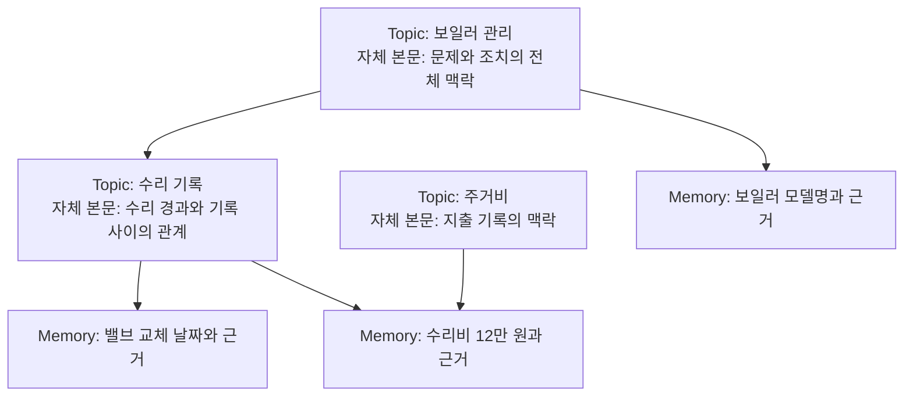

# 자체 본문을 가진 Topic과 Memory 계층 설계

- 작성일: 2026-10-01
- 상태: 설계, 미구현
- 기준: [기존 Memory Graph 설계](memory-graph-design.md)를 이후 논의에 따라 대체한다.

> 2026-10-06에 [Topic 구조 도입 판단기준](topic-adoption-criteria.md)을 새로 확정했다.
> 이 문서와 충돌하면 해당 판단기준을 우선한다. 특히 아래의 문단별 ACL 설계는 본문 전체에
> 동일 ACL을 적용한다는 확정 기준과 충돌하므로 재설계 대상이며, 그대로 구현하지 않는다.
> 현재 설계는 [Memory와 Topic 그래프 설계](topic-structure-proposal.md)다. Topic은 검색용 묶음과 그래프이며, 접근 권한은 입력의 원문과 파생 Memory를 기준으로 관리한다. 아래 설계를 그대로 구현하지 않는다.

## 1. 목적과 결정

Memory는 근거가 있는 독립적인 기록이고, Topic은 하위 기록을 조직하면서 자체 내용을 갖는
상위 노드다. Topic의 자식은 다른 Topic 또는 Memory다. 부모 본문은 하위 내용을 이해하는 데
필요한 맥락·종합·관계를 담는다.

디렉토리와 그 안의 설명 문서는 이 관계를 이해하기 위한 비유다. 실제 README 파일이나 별도
README 객체를 만들지 않는다. Topic 자체의 본문으로 저장하며 정해진 절이나 문서 양식을 강제하지 않는다.

이번 설계의 결정은 다음과 같다.

1. Topic은 이름과 자체 본문을 갖는다. 고정된 `summary`나 `scopeDescription`을 별도로 두지 않는다.
2. 계층은 엄밀한 분류체계보다 내용을 함께 보관하고 관리하는 맥락을 표현한다.
3. 부모 본문은 하위 내용의 반복을 줄이면서 전체 맥락을 설명한다. 필요한 종합과 짧은 요약은 허용한다.
4. 하위 변경이 부모 설명에 영향을 줄 수 있으면 재검토 대상으로 기록하고 필요한 부분을 갱신한다.
5. 같은 Topic 본문 안에 공개 내용과 비공개 내용을 함께 보존한다. 본문 부분별로 근거와 ACL을 관리한다.
6. 최초 저장·배치에서는 Memory를 반드시 Topic에 넣는다. 이후 관계 변경으로 소속이 없어지는 것은 허용한다.
7. 복수 소속을 유지하고, Topic 포함 관계의 자기 참조와 순환을 금지한다.
8. 화면 투영, 펼치는 위치, 표시용 링크와 중복 묶음은 이번 설계에서 다루지 않는다.
9. 새 권한 모델은 등록된 공유 범위와 역할 기반 작업 권한으로 표준화한다. 사용자 집합의 모든
   조합이나 그룹 교집합마다 본문·권한 그룹을 자동 생성하지 않는다. 기존 ACL은 명시적 전환 전까지 보존한다.

## 2. 객체와 관계

| 객체 | 책임 | 핵심 저장 정보 |
|---|---|---|
| Memory | 독립적인 내용과 원문 근거 보존 | ID, content, evidence, ACL, 등록자, 저장 시각 |
| Topic | 관련 기록의 조직과 상위 설명 | ID, 이름, 노드 ACL, 본문 부분들과 개정 이력 |
| 본문 부분 | 같은 권한으로 다룰 수 있는 독립적인 설명 | ID, Topic ID, 순서, content, ACL, 근거 참조, 개정 이력 |
| 소속 관계 | Topic 아래의 Topic 또는 Memory 연결 | 관계 ID, 양 끝 ID, ACL, 생성 근거·주체 |

Topic과 Memory의 구분은 정보 종류를 사전 분류하는 enum이 아니라 구조적 역할의 구분이다.
`PROFILE`, `EVENT`, `RULE` 같은 내용 타입이나 별도 subject·certainty 필드는 도입하지 않는다.
대상·시점·조건·발화자·불확실성은 본문에 표현한다.

화살표는 저장된 소속 관계다. 동일 Memory를 여러 부모에 연결해도 내용·근거·검색 인덱스를
복제하지 않는다. 동일 Topic이 여러 부모에 속해도 Topic 자체의 본문은 하나다. 부모별 맥락은
각 부모의 본문에 기록한다.

노드는 이름이나 경로 대신 ID로 식별한다. Topic의 이름·본문·위치를 수정해도 같은 묶음을
이어 관리한다면 ID를 유지한다. 다른 대상의 기록을 분리하거나 묶음을 나눌 때 새 Topic을 만든다.
Topic은 자식이 없어도 자체 본문과 ID를 유지할 수 있다.

## 3. 계층을 만드는 기준

### 3.1 맥락에 따른 조직

배치 판단은 “고정된 자식 범위 전체가 부모 범위 안에 들어가는가”가 아니라 “이 묶음을 여기에서
함께 보관하고 관리하는 것이 자연스러운가”다. 이름뿐 아니라 허용된 본문과 실제 자식 내용을 보고 판단한다.

예를 들어 `이사` 아래에 `계약`, `견적`, `새집 설비`가 함께 있어도 된다. 모두 같은 종류의
정보일 필요는 없으며, 부모 본문이 함께 관리하는 이유와 맥락을 설명한다.

하위 Topic을 연결하면 그 아래 전체가 구조적으로 연결된다. 일부 Memory만 관련 있다면 해당
Memory만 연결한다. 단어가 비슷하다는 이유만으로 Topic 전체를 하위에 붙이지 않는다.
나중에 묶음의 내용이 달라지면 배치와 부모 설명을 재검토할 수 있다.

### 3.2 적정한 계층과 내용 중복

부모 본문은 자식 전체를 다시 쓰는 사본이 아니다. 상위에서는 전체 흐름·공통 배경·기록 사이의
관계를 설명하고, 구체적인 날짜·수치·개별 경과는 하위 기록과 근거에 남긴다.

다만 설명에 필요한 핵심 내용의 짧은 반복은 허용한다. 목표는 중복을 완전히 없애는 것이 아니라,
상위 내용만으로 전체 맥락을 이해하고 세부 근거는 하위에서 확인할 수 있는 구조다.

- Memory 하나마다 중간 Topic을 자동으로 만들지 않는다.
- 기존 Topic에 직접 넣어 충분하면 추가 계층을 만들지 않는다.
- 독립적인 설명과 관리가 필요한 묶음에 하위 Topic을 만든다.
- 부모와 자식의 설명이 거의 같고 분리된 역할이 없다면 계층 축소를 검토한다.
- 모든 내용에 고정된 깊이나 자식 수를 강제하지 않는다.

이 기준은 배치·재정리 판단 지침이다. DB가 강제할 불변식은 참조 무결성, 권한, 순환 금지와
변경의 원자성이며, 의미상 적절함을 숫자 임계값 하나로 대체하지 않는다.

## 4. 부모 본문의 저장 단위와 근거

### 4.1 본문은 하나, 권한 단위는 여러 부분

Topic의 자체 본문은 순서가 있는 본문 부분으로 구성한다. 별도의 범위 설명이나 두 번째 요약
문서를 두지 않는다. 부분을 나누는 목적은 서로 다른 권한·근거·변경 이력을 관리하기 위해서다.

문장마다 기계적으로 쪼개지 않고, 독립적으로 이해할 수 있으며 같은 공개 범위를 적용할 수 있는
문단 정도를 기본 단위로 삼는다. 정보 종류에 따른 고정 block type은 요구하지 않는다.

예를 들어 공개 Topic `집 관리`는 다음 본문 부분을 함께 저장할 수 있다.

| 본문 부분 | 열람 범위 | 근거 |
|---|---|---|
| 보일러는 2024년에 교체했다. | PUBLIC | Memory 12 |
| 교체 비용은 아버지가 개인 대출로 마련했다. | 등록된 `부모` 공유 그룹 | Memory 13 |
| 다음 점검은 11월에 진행한다. | PUBLIC | Memory 14 |

### 4.2 원래 기록과 종합 내용의 구분

독립적으로 보존할 내용과 원문 근거는 Memory에 둔다. Topic 본문은 이를 종합하고 설명할 수
있으며, 어떤 기록을 사용했는지 근거를 남긴다. 사실을 새로 보존하려면 원문 근거를 가진 Memory로
저장한다. 상위 설명이 작성되었다는 사실만으로 새로운 원문 근거가 생기는 것은 아니다.

본문 생성에 사용한 Memory와 하위 Topic의 본문 부분을 추적한다. 하위 본문을 사용한 경우
Topic ID만 저장하지 않고 사용한 부분의 ID·개정본과 그 근거 Memory까지 추적할 수 있어야 한다.
현재 변경 가능한 본문에만 연결해 과거 설명의 근거가 조용히 바뀌게 하지 않는다.

상위 내용을 다시 하위의 사실 근거로 사용하는 순환 추론은 허용하지 않는다. 종합 내용의 근거는
결국 원문에 연결된 Memory로 이어져야 한다. 일반적인 안내 문구에는 사실 근거를 억지로 만들지
않되, 비공개 자료에서 얻은 설명을 근거 없는 공개 안내로 취급하지 않는다.

### 4.3 본문 참조와 소속 관계의 분리

실제 자식 목록은 소속 관계가 결정한다. 본문에 노드 ID를 참조한다고 소속이 생기지 않으며,
본문이 모든 자식을 열거할 필요도 없다.

내용의 근거 참조는 특정 경로가 아니라 노드·본문 부분의 ID를 사용한다. 경로 변경만으로 사실
근거가 사라지지 않는다. 다만 “이 하위 묶음에 보관한다”처럼 소속 자체를 설명한 부분은 관계도
참조하고, 관계 변경 시 재검토 대상이 된다.

## 5. 권한

### 5.1 부모와 자식의 권한은 독립적이다

현재 구현의 `PUBLIC`과 immutable application `UserId` 집합 기반 `RESTRICTED` ACL은 표준화
모델을 구현하고 명시적으로 전환하기 전까지 유지한다. 신규 모델의 공유 범위와 기존 ACL의
처리 차이는 §5.4–5.8에서 정한다. 어느 모델에서도 소속 관계는 권한 상속 관계가 아니다.

| 상황 | 예시 | 계약 |
|---|---|---|
| 부모 제한, 자식 공개 | 경영진의 조직 개편 검토와 공개 부서 현황 | 자식 열람에 부모 열람 권한을 요구하지 않는다. |
| 부모 공개, 자식 제한 | 프로젝트 개요와 비공개 계약 조건 | 부모 열람으로 자식 권한을 얻지 않는다. |
| 본문 안에 서로 다른 권한 공존 | 공개 설비 현황과 비공개 비용 조달 설명 | 같은 Topic 안에서 본문 부분별 ACL을 적용한다. |

Topic의 노드 ACL은 그 존재·이름과 본문 접근의 상한이다. 각 본문 부분은 그보다 좁은 범위를
가질 수 있다. Topic을 볼 수 없는 사용자에게 그 내부 본문 부분을 독립적으로 공개하지 않는다.
자식 노드는 별도 객체이므로 자신의 ACL로 직접 조회할 수 있다.

소속 관계도 정보이므로 별도 ACL과 근거를 둔다. 사용자가 양 끝 노드와 관계 기록 모두를 볼 수
있어야 연결을 조회할 수 있다. 관계의 허용 범위는 양 끝과 사용한 근거의 허용 범위를 넘지 않는다.

### 5.2 생성 전에 공개 범위를 정한다

본문 부분의 열람 범위는 Topic과 해당 부분을 만드는 데 사용한 모든 자료가 허용하는 범위의
교집합 안에 있어야 한다. 무관한 비공개 자식이 존재한다는 이유로 부모 전체를 제한하지 않는다.

생성 작업에서는 먼저 결과의 공개 범위를 정하고, 그 범위의 사용자 모두가 읽을 수 있는 자료만
모델에 전달한다. 결과 범위는 §5.4의 등록된 공유 범위 중에서 선택하며, 사용자 집합의 교집합을
계산해 새 생성 범위로 저장하지 않는다. 모델을 호출한 사용자가 볼 수 있다는 조건만으로는 충분하지 않다.

공개 설명을 만드는 호출에 비공개 자료를 섞어 준 뒤, 최종 문장에서 민감한 단어를 지우는 방식은
사용하지 않는다. 인용 목록에서 빠졌어도 표현·결론에 영향을 줄 수 있으므로 입력 자료 전체가
출력 범위에 적합해야 한다. 제한된 설명은 해당 범위에 맞는 별도 생성 작업으로 만든다.

예를 들어 비공개 대출 기록에서 “최근 재정 부담 때문에 교체를 최소화한다”를 도출했다면 대출을
직접 언급하지 않아도 제한된 내용이다. 이름·문단 제목·안내 문구에도 같은 규칙을 적용한다.

원문과 Memory의 ACL은 재배치나 본문 갱신으로 넓히지 않는다. 본문 개정도 비공개 내용을
자동 공개하는 경로가 되어서는 안 된다. 공개 가능한 근거만 사용한 새로운 설명은 별도로 생성한다.
그룹에 명시적으로 공유된 새 기록은 §5.7의 구성원 변경 정책을 따른다. 이 정책을 기존 고정
사용자 ACL에 소급 적용하지 않는다.

### 5.3 문맥과 이력도 같은 경계를 따른다

각 본문 부분은 다른 권한의 부분 없이도 의미가 유지되어야 한다. 공개 문단이 비공개 문단을
가리키며 “이 문제 때문에”라고 설명하는 구조는 피한다. 함께 있어야 의미가 유지되는 설명은
하나의 권한 단위로 묶거나, 허용된 근거만으로 독립적인 문장으로 다시 작성한다.

조회·종합·검색용 자료 생성에서 권한 밖의 본문 부분, 참조, 개정 이력과 숨겨진 부분의 존재를
반환하지 않는다. 비공개 부분의 개정만으로 공개 설명을 다시 쓰거나 사용자에게 그 개정을 알리지 않는다.
내부 갱신 작업 상태는 사용자별 권한을 확인하지 않은 채 노출하지 않는다.

### 5.4 권한 조합을 만들지 않는 공유 범위

사용자 N명의 부분집합은 이론적으로 2^N개다. 기존 방식이 모든 조합을 반드시 생성하는 것은
아니지만, 임의 사용자 집합마다 영속 본문을 만들고 그 교집합까지 추가하면 범위가 늘어나는 것을
통제하기 어렵다. 단순히 사용자 집합에 그룹 이름을 붙이는 것만으로는 해결되지 않는다.

신규 기록은 다음 중 하나의 공유 범위를 참조하도록 한다.

| 범위 | 의미 | 관리 방식 |
|---|---|---|
| `PUBLIC` | 현재 애플리케이션에 등록·인가된 모든 사용자 | 현재 공개 계약 유지. 인터넷 공개를 뜻하지 않는다. |
| `GROUP(groupId)` | 등록된 공유 그룹의 현재 구성원 | 권한 있는 주체가 이름·목적·구성원을 관리 |
| `PERSONAL(userId)` | 지정된 application 사용자 한 명 | 임의 사용자 조합을 지원하는 예외로 확장하지 않음 |

`부모`, `재정 담당`, `프로젝트 A 참여자` 등은 데이터로 등록하는 공유 그룹의 예시다. 정보의
종류나 가족 역할을 코드 enum으로 고정하지 않는다. 사용자 ID는 기존 application `UserId`를
그대로 사용한다. 그룹은 여러 개 가입할 수 있지만 그룹끼리의 중첩·자동 상속은 첫 버전에서 지원하지 않는다.

각 source, Memory, Topic과 본문 부분은 공유 범위 하나를 참조한다. 임의 그룹 목록의 OR/AND
표현식을 기록마다 만들지 않는다. 함께 공유할 지속적인 업무 집단이 필요하면 권한 있는 주체가
그룹을 명시적으로 등록한다. 모델·추출기·교집합 계산이 그룹을 자동 생성하지 않는다.

소속 관계와 본문 접근에서는 관련 객체의 권한 조건을 모두 검사하되, 그 결과 사용자 집합을
새 그룹으로 저장하지 않는다. `GROUP(A)` Topic 안의 `GROUP(B)` 부분은 두 조건을 만족하는
사람만 읽을 수 있다. 생성의 안전 조건은 B 전체가 읽을 수 있는 입력으로 제한하고, A와 B의
현재 공통 구성원만 읽을 수 있는 자료까지 사용하는 방식으로 완화하지 않는다.

이 때문에 대상 범위 자체가 Topic ACL의 부분집합이어야 한다는 별도 그룹을 만들 필요는 없다.
실제 열람은 Topic ACL과 부분 ACL을 함께 만족해야 한다. §5.2의 교집합 조건은 이 유효 열람
범위에 대한 안전 조건이며, 추가 본문·그룹을 만들어야 한다는 뜻이 아니다.

### 5.5 역할과 자료의 공유 범위를 분리한다

작업 권한은 역할 기반으로 관리하고, 자료를 읽을 수 있는 집단은 위 공유 범위로 관리한다.
역할을 사용자·허용 작업과 연결하는 RBAC 개념을 참고하되, 이것만으로 자료별 공유와 파생 내용의
정보 흐름까지 해결한다고 보지 않는다. [NIST RBAC 설명](https://csrc.nist.gov/projects/role-based-access-control/faqs)

| 판단 | 예시 | 필요한 조건 |
|---|---|---|
| 자료 열람 | Memory·본문·원문 조회 | 등록 사용자 인가와 대상 공유 범위 충족 |
| 지식·구조 편집 | Topic 개정·배치·관계 해제 | 역할의 작업 권한과 대상 범위의 편집 권한 |
| 공유 그룹 관리 | 그룹 생성·구성원 변경 | 해당 그룹 관리 권한과 변경 이력 |

그룹을 관리할 수 있다는 이유로 모든 비공개 자료를 읽을 권한을 자동 부여하지 않는다. Topic의
상하 관계나 회사의 직급을 자료 열람 권한 상속으로 사용하지 않는다. 서비스·모델 작업도 명시된
작업 범위를 사용하며, 전체 자료를 읽고 모델에게 권한 판단을 맡기지 않는다.

### 5.6 본문 생성 수를 제한하는 정책

Topic마다 생성 대상으로 사용할 공유 범위를 명시적으로 등록한다. 기본 대상은 Topic 자체의
공유 범위 하나이며, 필요한 그룹 범위만 추가한다. 개인 범위는 요청된 Topic에서 필요할 때만
등록한다. 사용자 가입, 그룹 가입, 겹치는 구성원의 발견만으로 생성 대상을 추가하지 않는다.

- 하나의 Topic·대상 범위 안에서 여러 문단을 만들 수 있으나, 범위 조합별 전체 본문 버전은 만들지 않는다.
- 여러 그룹에 속한 사용자는 이미 저장된 허용 부분을 읽는다. 그 사용자의 그룹 조합 전용 부분은 생성하지 않는다.
- `maxGenerationScopesPerTopic`으로 개인 범위를 포함한 생성 대상 수를 제한한다. 초기 설정안은
  8개이며 실제 도입 시 조정한다. 한도 초과는 대상 등록을 거절하거나 기존 대상을 정리하도록 한다.
  범위를 자동 병합하거나 공개 범위를 넓혀 한도에 맞추지 않는다.
- 자료 변경은 등록된 대상 중 영향을 받는 범위의 작업만 예약하고, 동일 대상의 대기 갱신 요청은 합친다.
- 현재 개정본의 수는 문단 수에 따라 달라지지만, 생성 대상 범위 수는 설정 한도를 넘지 않는다.
  개정 이력 보존량은 별도 운영 항목이다.

첫 버전의 입력 결합은 `같은 공유 범위의 자료 + PUBLIC 자료`로 제한한다. 예를 들어 `부모`
그룹 설명에는 부모 그룹 자료와 공개 자료를 사용한다. `재정 담당` 그룹에도 속한 사람이 있더라도
그 사실만으로 재정 담당 그룹 자료를 함께 넣지 않는다. 현재 구성원이 우연히 동일한 그룹도
서로 다른 공유 계약으로 취급한다.

여러 범위의 자료를 종합할 수 있는 명시적 정책은 후속 확장으로 둔다. 그 전에는 각 범위의
설명을 따로 보존한다. 자료를 복제·재공유하거나 권한 교집합 그룹을 만들어 제한을 우회하지 않는다.
표준 범위로 표현할 수 없는 기존 ACL 자료는 원래 권한으로 직접 조회할 수 있지만, 자동으로
새 그룹용 종합에 넣지 않는다.

예를 들어 사용자 1,000명이 있고 한 Topic의 생성 대상이 `PUBLIC`, `프로젝트 A`, `재정 담당`
세 개라면 생성 범위는 세 개다. 프로젝트 A와 재정 담당 양쪽에 속한 사람을 위한 네 번째 범위를
만들지 않는다. 그 사용자는 두 그룹의 허용 부분을 모두 읽는다. 따라서 이 정책의 생성 대상은
사용자의 가능한 부분집합 수가 아니라 Topic에 명시적으로 등록한 범위 수에 비례한다.

### 5.7 그룹 구성원 변경과 과거 자료

신규 `GROUP` 공유는 현재 구성원에게 그 그룹의 과거 자료도 공유하는 계약으로 정의한다.
그룹 가입은 과거 Memory·본문·원문 근거에 대한 접근 부여이고, 탈퇴는 이후 접근 회수다.
이 의미를 그룹 관리 작업에서 명시하고 권한 있는 주체만 변경하도록 한다. 과거 자료의 공개가
의도와 다르면 해당 그룹에 가입시키지 않고 별도 그룹 또는 개인 범위를 선택한다.

그룹 ID와 자료의 공유 대상은 유지하고, 구성원 변경은 명시적인 권한 변경으로 이력을 남긴다.
그룹 소속 변경을 기존 immutable 사용자 ACL의 단순 표시 이름 변경처럼 취급하지 않는다.

- 조회·다운로드·검색·본문 종합 등 모든 요청에서 현재 권한을 검사한다. 인덱스·세션에 남아 있는
  과거 권한만 신뢰하지 않는다. [OWASP 인가 지침](https://cheatsheetseries.owasp.org/cheatsheets/Authorization_Cheat_Sheet.html)
- 그룹·정책 버전을 두고 권한 캐시를 무효화한다. 버전 확인 실패는 허용으로 처리하지 않는다.
- 생성 작업은 사용한 범위·정책 버전을 기록하고, 적용 전에 재검증한다. 처리 중 변경되었으면
  새 정책으로 다시 검증하거나 재시도하며, 오래된 입력으로 새 공개 범위의 결과를 확정하지 않는다.
- 같은 범위+PUBLIC만으로 만든 종합은 가입자에게 원래 근거도 함께 공유되므로, 구성원이 늘었다는
  이유만으로 내용을 다시 생성할 필요는 없다. 공유 대상 변경이나 근거 정책 변경은 별도 검증한다.
- 그룹 삭제는 PUBLIC 전환이 아니다. 참조 중인 그룹은 삭제를 거절하거나 비활성화해 접근을 차단한다.
- 회수 대상은 시스템의 이후 접근이다. 이미 내려받은 내용을 소급 회수했다고 보장하지 않는다.

### 5.8 기존 ACL 보존과 도입 순서

현재 저장된 고정 `allowedUserIds`는 그대로 해석한다. 현재 구성원이 같다는 이유만으로 변경 가능한
그룹으로 치환하지 않는다. 그러면 미래 가입자에게 과거 비공개 자료가 공개될 수 있기 때문이다.
기존 ACL마다 자동 그룹을 만들거나 모든 기존 범위에 대한 본문을 생성하는 방법도 사용하지 않는다.

다음 순서로 도입한다. 이 문서는 계획이며 기존 권한이나 데이터를 변경하지 않는다.

1. application의 공통 인가 경계에서 `사용자·작업·자원` 권한을 판단하고 현재 ACL 해석을 보존한다.
2. 공유 그룹·구성원·관리 권한·정책 버전·변경 이력을 추가한다. 역할 기반 작업 권한과 자료 공유를 분리한다.
3. 신규 입력에 PUBLIC/GROUP/PERSONAL 선택을 도입한다. source와 Memory가 같은 공유 계약을
   보존하도록 한다. 서로 다른 제한 범위의 source는 범위별로 분석하고, 다른 범위의 자료를
   해석용 문맥으로 섞지 않는다. 한 Memory로 합쳐 새 권한 조합을 만들지 않고 원문과 각 기록을 보존한다.
4. Topic 본문에 범위 참조와 생성 대상 목록·한도를 적용하고, 같은 범위+PUBLIC 입력 규칙을 강제한다.
5. 기존 ACL 자료는 호환 경로로 유지한다. 전환은 대상 자료, 원문 근거, 파생 내용, 과거 자료 접근과
   그룹 가입 효과를 검토한 별도 작업으로 수행한다. 이름만 바꿔 기존 권한이 보존됐다고 판단하지 않는다.
6. 구성원 변경 중 조회·생성·캐시·검색과 기존 ACL 회귀 사례를 검증한 뒤 신규 모델을 활성화한다.

기존 자료를 전환하지 않아도 신규 표준 범위와 병행 운영할 수 있어야 한다. 현재의 사용자 기반
근거·요청 중복 방지·대화 lease 계약과 사용자 소유 학습 과제는 이 변경과 분리한다.

## 6. 최초 배치와 이후 미분류

### 6.1 최초 저장에는 실제 Topic 소속을 보장한다

새 Memory를 확정할 때 적어도 하나의 실제 Topic 관계를 함께 저장한다. 적절한 일반 Topic을
아직 정하지 못했다면 시스템 `미분류` Topic에 넣는다. 가상 목록이나 별도 Memory 저장소로 만들지 않는다.

모델의 배치 판단 때문에 수집이 중단되지 않도록 기본 흐름은 다음과 같다.

1. 원본 source를 보존하고 내용과 근거를 분석한다.
2. Memory·근거·ACL·미분류 관계와 필요한 후속 작업을 하나의 트랜잭션으로 확정한다.
3. 일반 Topic 배치는 별도 작업으로 제안·검증·적용한다.
4. 일반 관계 추가와 해당 미분류 관계 해제를 하나의 변경으로 적용한다. 배치에 실패하면
   기존 Memory와 미분류 소속을 유지하고 재시도한다.

신규 미분류 Topic은 Memory와 같은 표준 공유 범위 ID별로 재사용한다. 그룹 구성원이 바뀌어도
새 사용자 집합별 Topic을 만들지 않는다. 이를 통해 최초 Memory의 열람자 모두가 초기 소속에도
접근할 수 있다. 같은 범위에 대한 생성·관계 저장은 재시도와 동시 실행에도 중복되지 않아야 한다.
기존 ACL 자료를 새 그래프로 옮기는 작업은 별도 전환 범위이며, 그 과정에서 기존 ACL을 자동으로
그룹화하지 않는다. 기존 고정 ACL의 초기 소속이 필요하면 그 ACL을 그대로 보존한 관계로 처리하고
해당 범위를 새 자동 본문 생성 대상으로 승격하지 않는다.

최초 확정 트랜잭션이 실패하면 부분적으로 성공한 Memory로 취급하지 않는다. source는 분석
재시도 대상으로 남긴다. 이미 확정된 Memory는 이후 배치나 본문 생성 실패로 롤백하지 않는다.

### 6.2 변경 이후에는 소속이 없어도 된다

관계 해제·Topic 삭제·재정리 결과 Memory의 부모가 0개가 되는 상태를 허용한다. 자동으로
미분류 Topic에 다시 넣을 의무는 없다. 내용·근거·ACL·ID는 그대로 보존한다.

따라서 다음 상태는 서로 다르다.

- 미분류 Topic에 저장된 Memory: 실제 소속이 있고 아직 일반 배치를 완료하지 않은 기록
- 변경 이후 소속이 없는 Memory: 어떤 Topic→Memory 관계도 없는 기록
- 사용자에게 부모가 보이지 않는 Memory: 저장 관계는 있으나 그 사용자가 연결을 읽을 수 없는 기록

세 경우 모두 Memory 자체의 ACL에 따라 직접 검색할 수 있다. 별도 검색 인덱스는 필요 없다.
소속 없는 Memory의 재배치 후보를 찾는 관계 조회는 필요하지만, 전역 관계의 존재 여부를 무권한
사용자에게 공개하지 않는다. 사용자에게 읽을 수 있는 부모가 없다는 이유만으로 저장된 관계를
삭제하거나 실제 미분류라고 단정하지 않는다.

“최초에는 소속이 있어야 한다”는 생성 use case의 조건이다. 모든 시점에 부모 수가 1 이상이어야
한다는 영구 DB 제약으로 구현하지 않는다.

## 7. 하위 변경과 부모 내용 갱신

Memory·소속 관계·하위 본문이 바뀌면 영향을 받을 수 있는 부모 설명을 재검토 대상으로 기록한다.
자식 추가가 본문에 영향을 주지 않으면 내용 개정 없이 검토 완료로 처리할 수 있다.

예를 들어 “수리는 한 차례 진행됐다”라는 설명이 있는 부모에 두 번째 수리 Memory가 추가되면
그 설명은 재검토가 필요하다. 본문이 자식 전체를 열거하지 않는다는 이유로 이 변경을 무시하지 않는다.

- Memory와 관계 변경의 확정, 재검토 요청 기록은 원자적으로 수행한다.
- 모델을 호출하는 갱신 작업은 트랜잭션 밖에서 수행하고 실패를 기록해 재시도한다.
- 사용한 근거와 관계 상태를 적용 직전에 확인한다. 오래된 상태에서 만든 결과는 다시 계산한다.
- 생성 대상은 등록된 공유 범위로 제한하고 그룹·정책 버전도 확인한다. 사용자 조합별 갱신 작업을 만들지 않는다.
- 영향을 받는 부분만 적절한 ACL의 자료로 갱신한다. 비공개 변경을 공개 문단 생성에 섞지 않는다.
- 새 개정본과 근거를 함께 확정하고, 이전 개정본의 권한과 근거도 보존한다.
- 갱신 실패가 새 Memory나 정상 소속을 취소하지 않는다. 종합에 사용하는 본문 부분은 최신성
  상태를 구분하고, 오래된 설명을 최신 구조로 검증된 내용처럼 사용하지 않는다.

복수 부모라면 각 부모의 영향을 따로 확인한다. 재검토 작업은 합칠 수 있지만 특정 부모를 빠뜨리지
않는다. 상위가 직접 참조하는 근거가 바뀌었거나 하위 본문 개정이 상위 설명에 영향을 주면 그
상위도 재검토한다. 영향 추적은 참조한 근거와 관계 변경을 함께 사용하며 전체 그래프를 매번 재작성하지 않는다.

## 8. 구조 변경과 무결성

- Memory는 자식을 갖지 않는다. Topic은 Topic과 Memory를 함께 포함할 수 있다.
- 노드는 복수 부모를 가질 수 있으며, 모든 저장 관계를 합친 Topic 그래프는 DAG여야 한다.
- 같은 두 노드 사이에 근거·ACL이 다른 관계 기록을 둘 수 있다. 한 기록의 해제가 다른 기록을
  삭제하지 않으며, 관계가 하나 이상 남아 있으면 논리적 소속도 유지된다.
- 관계 변경은 Memory의 내용·근거·ACL을 바꾸지 않는다. Topic 삭제도 Memory를 연쇄 삭제하지 않는다.
- 이동은 해제할 관계와 추가할 관계를 명시한다. 사용자에게 보이지 않는 다른 소속을 암묵적으로 해제하지 않는다.
- 이름이 비슷하다는 이유만으로 Topic이나 Memory를 자동 병합하지 않는다. ACL이 다른 동일 내용도 별도 기록으로 보존한다.
- 같은 요청의 재시도는 동일한 노드·관계·개정본을 중복 생성하지 않는다.

구조 변경은 제안과 적용을 분리한다. 적용 시 대상 상태·편집 권한·참조·전역 순환을 검증하고,
하나의 변경을 한 트랜잭션으로 적용하거나 모두 거절한다. 동시 변경 사이의 순환도 방지하도록
검사와 적용을 같은 DB 동시성 제어 안에서 수행한다. 프로세스 내부 mutex만으로 보장하지 않는다.

전역 순환 검사는 application이 모든 관계를 대상으로 수행하고, 그 자료를 모델에 전달하지 않는다.
숨겨진 관계 때문에 구조 변경이 거절될 수 있으므로 쓰기 승인 결과까지 비공개 정보와 무관하다고
보장하지 않는다. 거절 결과에 비공개 노드·관계·근거는 포함하지 않는다. 단순 오류 문구 통일만으로
모든 간접 추론을 막았다고 간주하지 않으며, 사용자별 편집 권한과 쓰기 API 정책은 구현 전에 확정한다.

병합·분할은 본문 부분·근거·소속·권한을 함께 다루는 명시적 계획으로 수행한다. 이전 ID 참조를
유지할 필요가 있으면 대표 ID 대응을 남기고 그 조회에도 권한을 적용한다. 변경 이력을 보존하며,
되돌리기는 현재 상태를 검증하는 새 변경으로 수행해 그 사이의 다른 작업을 덮어쓰지 않는다.

## 9. 저장·조회와 구현 경계

기존 SQLite 안에 Topic, 본문 부분과 개정 이력·근거, Topic→Topic, Topic→Memory 관계와 ACL,
본문 재검토 작업을 저장하면 된다. 공유 그룹·구성원·역할별 작업 권한·범위 참조와 정책 변경 이력도
같은 저장소에서 관리한다. 자식 종류별 관계 테이블로 외래 키를 명확히 한다. 별도 그래프
DB, 파일 시스템 서비스나 범용 문서 편집기를 전제로 하지 않는다.

자식과 하위 Memory 조회는 관계를 기준으로 수행하고, 같은 Memory에 여러 경로로 도달하면
ID로 중복을 제거한다. 본문을 근거로 자식 목록을 추측하지 않는다. 소속 관계와 본문 근거 참조는
서로 다른 연결이며, 근거 참조를 자식 순회에 사용하지 않는다.

Memory의 직접 검색을 유지한다. Topic이나 본문을 추가로 검색에 활용할지는 후속 결정이다.
어떤 경로를 사용하든 같은 Memory·근거·ACL을 사용하고, 권한 밖의 자료를 먼저 모델에 제공한 뒤
출력만 거르는 방식은 사용하지 않는다. 이번 문서 작업에는 검색 품질 평가를 포함하지 않는다.

현재 구현은 Memory의 `memoryType`, `certainty`, `subject`와 DB `updatedAt` 제거까지 완료됐다.
Topic과 부분별 본문·갱신 구조는 아직 구현하지 않았다. 기존 `Memory.childrenIds`는 새 관계
모델 구현 시 대체한다. 이 문서는 코드 구현, 배포, DB 초기화나 데이터 변환을 수행한 기록이 아니다.

## 10. 후속 구현의 검증 사례

1. Topic 아래에 Topic과 Memory가 함께 저장되며, Topic의 본문 개정만으로 ID가 바뀌지 않는다.
2. 동일 Memory·Topic의 복수 소속이 실제 내용·근거를 복제하지 않는다.
3. 최초 저장은 Memory와 실제 Topic 관계를 함께 확정한다. 실패 시 source를 재시도할 수 있다.
4. 최초 일반 배치 실패는 미분류 소속을 보존한다. 이후 마지막 관계 해제는 소속 없는 Memory를 허용한다.
5. 비공개 부모의 공개 자식과 공개 부모의 비공개 자식이 서로의 ACL을 넓히거나 좁히지 않는다.
6. 같은 Topic에 공개·제한 본문 부분을 함께 저장하고, 참조·개정 이력까지 부분별 권한을 적용한다.
7. 공개 본문 생성 입력에 비공개 Memory나 본문 부분이 포함되지 않는다. 호출자의 권한만으로 통과시키지 않는다.
8. 다른 권한의 문단을 제거해도 공개 부분이 독립적으로 이해되며, 비공개 사실을 암시하는 문맥을 남기지 않는다.
9. 부모를 작성한 근거 Memory와 하위 본문 개정본을 추적하며, 과거 근거가 현재 본문으로 조용히 대체되지 않는다.
10. 하위 변경 후 본문 재검토 요청이 남고, 실패·재시도·동시 변경에도 Memory 저장과 올바른 소속이 유지된다.
11. 여러 부모 중 영향을 받는 설명이 갱신에서 누락되지 않고, 비공개 변경이 공개 본문을 오염시키지 않는다.
12. 전역 순환과 동시 변경으로 발생하는 순환을 거절하며, 실패 응답에 비공개 자료를 포함하지 않는다.
13. Topic 삭제·병합·분할·복구가 원래 Memory와 다른 작업의 관계를 소실시키지 않는다.
14. 사용자 1,000명과 겹치는 그룹이 있어도 등록한 생성 범위만 처리하고 교집합 그룹이나 조합별 본문을 만들지 않는다.
15. 생성 범위 한도 초과가 거절되며, 이를 해결하기 위해 기존 자료 권한을 넓히지 않는다.
16. 구성원이 현재 같은 두 그룹의 자료를 자동 결합하지 않는다. 같은 범위+PUBLIC 입력 규칙을 검증한다.
17. 그룹 가입자는 그 그룹의 과거 자료에 접근하고 탈퇴자는 이후 접근할 수 없다. 캐시·검색·생성 중 변경에도 적용된다.
18. 기존 allowedUserIds는 그룹 구성원 변경의 영향을 받지 않으며, 자동 전환이나 신규 그룹원의 과거 접근이 생기지 않는다.
19. 그룹 관리 역할이 비공개 자료의 열람을 우회하지 않으며, 참조 중인 그룹 삭제로 자료가 공개되지 않는다.

## 11. 기존 설계에서 바뀐 점

| 기존 결정 | 이 문서의 결정 |
|---|---|
| 고정 summary와 수정 가능한 본문 분리 | 자체 본문만 유지하고 부분별로 근거·ACL·개정 관리 |
| 고정 범위의 포함 관계로 배치 | 실제 내용과 함께 관리할 맥락으로 배치 |
| 하위 종합에 대한 제한 | 중복을 줄이는 종합·맥락·필요한 요약 허용 |
| 모든 일반 Topic은 자식 필수 | 빈 Topic 허용 |
| 모든 시점에 Memory 소속과 사용자별 경로 보장 | 최초 실제 소속 보장, 이후 변경에 따른 소속 없음 허용 |
| 화면 트리 투영·표시용 중복 통합 | 이번 설계에서 제외 |
| 임의 사용자 집합별 본문 생성 가능 | 등록된 표준 공유 범위와 Topic별 생성 한도, 조합별 생성 금지 |

단일 본문 ACL이나 공통 설명만 보존하는 대안은 채택하지 않는다. 부모 자체에 비공개 종합 내용도
축적해야 하므로 본문 부분별 권한을 저장 모델에 포함한다. 자동 의미 중복 판정, 자유로운 RELATED
관계와 구조 편집 UI는 선행 조건으로 요구하지 않는다.

## 참고

- [이전 설계](memory-graph-design.md): 변경 전 결정과 배경
- [구조 조사](research/memory-consolidation-and-topic-hierarchy.md)
- [운영 참고](research/memory-consolidation-operations-notes.md)
- [현재 Memory 저장 use case](../application/src/main/kotlin/com/homeassistant/application/usecase/memory/write/README.md)
- [현재 Memory 배치 use case](../application/src/main/kotlin/com/homeassistant/application/usecase/memory/placement/README.md)

기존 문서와 충돌하면 이 문서의 결정을 우선한다. 구체 테이블·포트·작업 상태와 편집 권한 정책은
이 계약과 §5.8의 도입 순서를 바탕으로 후속 구현 계획에서 확정한다. 그룹 기반 신규 정책을 기존
사용자 ACL에 소급 적용하려면 별도의 명시적 전환이 필요하다.
